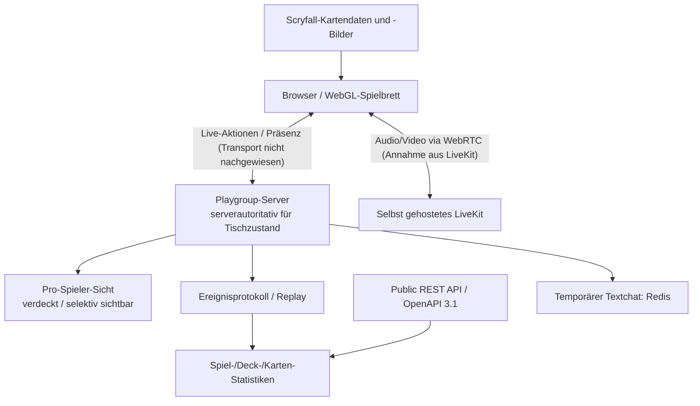
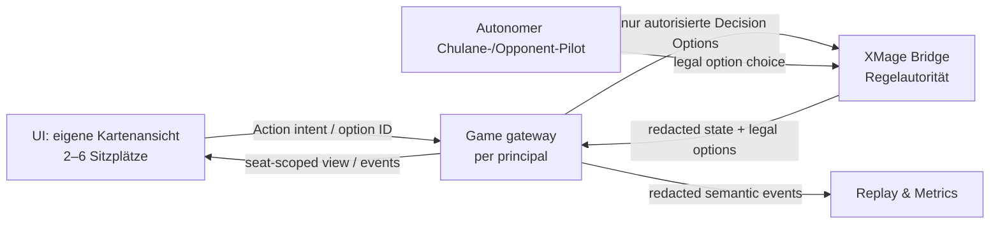

# Playgroup Live — Phase 1: Quellcode- und Architektur-Audit

**Datum:** 2026-11-08 · **Referenz:** https://playgroup.gg/playgroup-live · **Untersuchungsumfang:** öffentliche GitHub-Repositories und auslieferbare Client-Technik, WebGL, öffentliche API, Serverzustand/Datenschutz, tatsächliche Regel-Automatisierung, Lizenzen, Spielergrenze, Übertragbarkeit auf Commander Playtest Lab. **Kein Zugriff auf Playgroups private Repositories, interne Server, authentifizierte Browser-Sitzungen, Bundles oder Source Maps.**

**Projektentscheidung:** Neue Commander-Simulationen sind **für dauerhaft maximal sechs Spieler** ausgelegt, standardmäßig vier. Kein 7/8-Spieler-Ziel und keine 7+ Operationaltests. Verbindliche Ablage: [OWNER_DECISION_SIX_PLAYER_MAX_20261108.md](../OWNER_DECISION_SIX_PLAYER_MAX_20261108.md).

## 0. Befundklassen und Untersuchungsmethode

- **DIREKT BESTÄTIGT:** ausdrücklich in einer verlinkten offiziellen Playgroup-Seite/API-Doku beschrieben, oder durch identifizierbaren Lab-Quellcode nachgewiesen; Selbstangaben des Anbieters sind keine unabhängigen Laufzeittests.
- **ABGELEITET:** plausible Architekturfolgerung, bei der mindestens ein Detail nicht öffentlich belegt ist.
- **NICHT BESTÄTIGT:** mangels Code-/Sitzungszugriff nicht objektiv verifizierbar. `NOT_FOUND` bedeutet nicht `DOES_NOT_EXIST`.
- **NICHT AUSGEFÜHRT:** Browser-Demospiel, DevTools-Network-Traffic, JavaScript-Bundle- und Source-Map-Analyse, Live-6P-Stresstest, Lizenzprüfung jedes einzelnen Client-Abhängigkeitspakets.

Quellen: offizielle Produkt-/Feature-/Sparring-/API-/Datenschutz-/Rechtsseiten und das datierte Entwickler-Update vom 2026-07-10; zusätzlich GitHub-Repository-Discovery mit Suchbegriffen `playgroup.gg`, `playgroup-live`, `playgroup commander`, `Arcane Digital MTG`, `playgroup mtg`. Die öffentliche GitHub-Suche fand **kein als offizieller vollständiger Playgroup-Live-Quellcode identifizierbares Repo**. Gefundene Community-Helfer und andere Commander-Simulatoren sind **keine** Playgroup-Originalquellen.

## 1. Öffentlicher Architektur-Querschnitt

Diese Abbildung ist **eine rekonstruierte Komponentensicht**, keine aus Playgroups Source extrahierte Implementierungsarchitektur. Insbesondere ist nicht verifiziert, wie Live-Aktionen serialisiert oder zwischen Server und Clients transportiert werden (WebSocket, SSE, Polling, proprietäres Protokoll), wie/wo der eigentliche Sitzungszustand persistent gespeichert wird, und welcher Rendering-Framework-Code verwendet wird.

### Schichten und Evidenz

| Schicht | Öffentlich belegbarer Befund | Status |
|---|---|---|
| Browser | Vollständiges virtueller Commander-Tisch in einem Browser-Tab, Desktop, Tablet-Beta, mobile Spezialansicht | DIREKT BESTÄTIGT |
| Rendering | **WebGL ist zwingend**; bei fehlendem WebGL-Kontext erscheint ein Fehlerbildschirm; Rendering/Memory/Schatten für große Boards optimiert | DIREKT BESTÄTIGT |
| Konkretes Framework | PixiJS, Phaser, Three.js, React, Vue, Svelte, Rails, Godot für *Playgroup Live*: keine sichere Framework-Identifikation | NICHT BESTÄTIGT |
| Live-Multiplayer | 2–6 gleichzeitige Spieler; Karte-Drag-Vorschau und aktive Spielersitzmarkierung; Host-Wechsel nach Disconnect | DIREKT BESTÄTIGT |
| Spielzustand | Serverautoritativer Tischzustand; Hand/Bibliothek/exilierte verdeckte Karten mit pro-Spieler-Sichtbarkeit; Server-RNG für Würfel/Münzen | DIREKT BESTÄTIGT (Herstellerangabe) |
| Kartendaten | Scryfall als Quelle für Kartennamen, Bilder und lokalisierte Drucke; pro Spieler unterschiedliche Anzeigesprache | DIREKT BESTÄTIGT |
| Voice/Kamera | LiveKit, von Playgroup auf eigenen Servern betrieben; keine laufende Sprach-/Video-Aufzeichnung | DIREKT BESTÄTIGT (Datenschutzhinweis 2026-10-26) |
| Textchat | Temporäre Redis-Nachrichten; aktuell bis 24h nach Spielende, 48h bei unfertigen Spielen; Zuschauer ohne Chat | DIREKT BESTÄTIGT (Datenschutzhinweis 2026-10-26) |
| Zustandshistorie | Ereignislog bei jeder Aktion und Replay vergangener Partien mit Full-Reveal nach dem Ende; Spielstatistiken werden gespeichert | DIREKT BESTÄTIGT |
| Proprietäre Backend-Technik | SQL-Datenbank, Realtime-Broker/Queues, Auth-Bibliotheken, interne Schnittstellen, konkretes Hosting | NICHT BESTÄTIGT |
| Kamera-Card-Recognition | Bei Hybrid-Papierspielen wird Karte lokal im Browser zugeschnitten, an eigenen Erkennungsdienst gesendet und durch Nutzer bestätigt | DIREKT BESTÄTIGT |
| Live-Sparring | Statistik-/Wahrscheinlichkeitsmodell; **keine** vollständige Magic-Rule-Engine und **keine autonome Deck-gegen-Deck-KI** | DIREKT BESTÄTIGT |

**Wichtige Abgrenzung:** Das mobile `Playgroup.gg – Commander App` verwendet laut Entwicklereintrag **Godot 4** als Lebenspunkte-Tracker. Das ist **kein Beleg**, dass Playgroup Live im Browser Godot nutzt. Für den Browser wurde nur die erforderliche WebGL-Schnittstelle nachgewiesen.

### UI-/Interaktionsumfang

Offiziell dokumentiert: Hand, Battlefield, Graveyard, Exile, Library, Command Zone, separate Stack-Zone, Tap/Untap, Flip/Transform, Phase-in/-out, Attachments, Markierungen, Target-Arrows, Marquee-Selection, Token, Counters, Lebenspunkte, Commander-Schaden, Poison, Rad, Monarch, Embleme, aktive Spieler, Extra Turns, Aktionen per Tastaturkürzel, Deck HUD (Scry, Surveil, Look, Tutor, Reveal-until, Cascade, Discover, Mill, Shuffle), Sprachwahl pro Sitz, Spiele beobachten, Replays und Undo. Die einzelnen Funktionen sind dokumentiert; **ihre konkrete Laufzeitkorrektheit wurde hier nicht geprüft**.

## 2. Regel-Autorität: „Rule Assist“ versus vollständige Engine

**Entscheidender Unterschied:** Playgroup beschreibt sich als virtuelles Spielfeld mit umfassender *Buchhaltung*, Karten- und Zonenhilfen. Es behauptet an einer FAQ-Stelle auch, „every Commander rule [is] handled automatically“, zugleich sind manuelle Nutzerentscheidungen und Sparring ohne echte Regeln dokumentiert. Eine vollständige, öffentliche Engine-Implementierung oder ein XMage-/Forge-Anschluss konnte nicht nachgewiesen werden. **Nicht behaupten, dass Playgroup die Comprehensive Rules vollständig durchsetzt.**

Datenbeispiele:
- **Automatisierte Helfer:** Scry, Surveil, Cascade/Discover, Bibliothekssuche, Face-down-Rechte, Counters, Commander-Schaden, Stack-/Zonenverwaltung.
- **Spielersteuerung:** Karten bewegen, Ziele markieren, zusätzliche Trigger nicht zwangsläufig von einer Engine erzwungen; Event Log hilft vergessene Trigger zu erkennen; Support/Discord-Judge bei Streit.
- **Sparring:** Anbieter bestätigt ausdrücklich: *kein Regelkern, keine KI*. Reaktion basiert auf Häufigkeitsverteilungen mit ungefähr 120 kuratierten Antwortkarten, Nutzer kann die Reaktion akzeptieren oder ohne maschinellen Hand-/Mana-Nachweis abwehren. Grundlage: 21.480 Interaktionsspells aus 6.934 aufgezeichneten Partien; Boardwipe-Rate nach Boardbreite gewichtet. Das ist **kein Beleg für reale, regelkonforme gegnerische Kartenplays**.

**Für unser Lab:** XMage entscheidet in allen Modi legal verfügbare Aktionen, Targets, Kosten, Priorität, Stack, Zonen, Trigger, Lebenspunkt-/Schadensregeln, Zufall und Ergebnis. Pilot/KI und UI dürfen ausschließlich XMage-zugelassene Optionen auswählen und anzeigen. Reuse Playgroup als **UX-Referenz**, niemals als Rules Engine. Ein generisches „Undo“ oder manuelles Verschieben, das Regeln umgeht, darf nicht ungeprüft in unser produktives XMage-Spiel gelangen.

## 3. Öffentliche API: vorhanden, aber kein belegter Live-Game-State-Connector

**Dokumentation:** https://playgroup.gg/api-docs/index.html (OpenAPI **3.1**, public API v1). Das dort referenzierte Schema liegt unter `/api/public/v1/openapi.yaml`. Der rohe YAML-Dateiaufruf war aus der hier vorhandenen Suchumgebung nicht zugänglich; die HTML-Swagger-Ansicht war lesbar.

Dokumentierte API-Familien:

| Familie | Repräsentative Pfade | Auth laut Doku |
|---|---|---|
| Commander-Stats | `GET /commanders/{id}`, `GET /commanders/by_name/{name}`, `GET /commanders/turn_damage` | öffentlich |
| Nutzer | `GET /users/{id}`, `GET /me` | öffentliches Profil bzw. eigene Identität |
| Decks | `GET /decks/{id}`, `GET /decks/{id}/elo_history`, `GET /users/{user_id}/decks` | öffentliche Decks ohne, private mit Berechtigung |
| Playgroups | `GET /users/{id}/playgroups`, `GET /playgroups/{id}/members` | abhängig von Sichtbarkeit |
| Games | `GET /playgroups/{id}/games`, `GET /playgroups/{id}/games/{game_id}` | Playgroup-Mitgliedschaft erforderlich |
| Ereignisse | `POST /games/{game_id}/events/batch` | Import-Endpunkt, nicht als öffentlicher Live-Sync-Socket bewiesen |
| Live-Sessions | `POST /live_sessions` | Endpunkt dokumentiert; Berechtigung/Request-Schema hier nicht geprüft |

**Publizierte Limits:** 400 Requests/Minute/IP bei identifizierendem `User-Agent`, 10 ohne; 429 und `Retry-After` bei Drosselung. Diese Limits gelten laut Swagger für die öffentliche API, **nicht** nachweislich für Playgroup-Interna. Keine authentifizierte Abfrage durchgeführt. Der offizielle REST-Katalog stellt **keine nachweislich dokumentierte Echtzeit-State-/Entscheidungsstream-API** bereit, mit der wir ihre Spielfeld-Implementierung einfach übernehmen könnten.

**Datenschutzvorgabe für unser Projekt:** Öffentliche anonymisierte Aggregatdaten können in einem späteren, separaten Workstream mit Lizenz-Attribution und lokalem Cache evaluiert werden. **Niemals** unsere private Chulane-Liste, eine Sammlung, Teilkartenfolgen, verdeckte Informationen oder Simulator-Decision-Tapes an öffentliche fremde APIs senden.

## 4. Quellcode- und Client-Dateien-Suche

### Was gesucht wurde
1. Offizielle Hersteller-Webseiten, FAQ, Entwicklungs-Updates, Datenschutz, Impressum, Swagger.
2. GitHub-Repository-Suche nach `playgroup.gg`, `playgroup-live`, `playgroup commander`, `Arcane Digital MTG` und `playgroup mtg`.
3. Suchmaschinenabfragen nach öffentlichem Backend-, Frontend- und GitHub-Code, WebGL-Bibliotheken, APIs, möglichen Framework- oder Build-System-Nennungen.

### Ergebnis
- **Kein eindeutig offizielles öffentliches Playgroup-Live-Repository identifiziert.** Gefundene Community-Helfer und ähnlich benannte Repositories sind kein Lizenz- oder Codebeleg für den Hersteller.
- **Keine validierten Original-JavaScript-/CSS-Bundle-URLs, Source Maps, package.json, Deployment-Manifeste oder Serverquellen.** Öffentliche Produktseiten und eine WebGL-Fehleransicht waren abrufbar; jedoch kein browserinteraktiver DevTools- oder Asset-Byte-Zugriff auf `/live_sessions/…`. Die beabsichtigte rohe HTTP-Site-Abfrage war in der Runtime durch DNS-/Netzwerkzugriff blockiert.
- Die konkret verwendete WebGL-Bibliothek (z.B. Three.js vs. PixiJS), Render-Batching-Verfahren, Framework- und Server-Sprache sind daher **UNKNOWN**. Keine fiktive Identifikation.
- Playgroup erwähnt eigene Infrastruktur und bietet bei Bedarf *custom development* an; das ist **keine** Open-Source-Freigabe oder Wiederverwendungserlaubnis.

### Nicht invasive Folgeprüfung, falls später Browserzugriff besteht
Öffentliche Demo ohne Owner-Daten starten → Browser DevTools: HTML-`script`-/`link`-Assets, response headers, öffentlich ausgelieferte Bundle-Fingerprints, WebGL-Renderer, Netzwerk-Transportkategorie, Payload-Redaktion nach Sichtrechten, GPU-Canvas-Profile und Reconnect-Verhalten feststellen. Nur eigene Demo-Daten; keine fremden Räume, privaten Endpunkte, Auth-Bypässe oder Rekonstruktion nicht freigegebenen proprietären Quellcodes. Das ist **Phase 6 / browserbasierter Funktionstest**, nicht als erledigte Codeinspektion ausgegeben.

## 5. Warum sechs? Ursachenanalyse und unsere dauerhafte Entscheidung

**Hersteller-Fakt:** 2–6 Spieler pro Multiplayer-Session. Eine eindeutige technische Begründung des Herstellers für *genau sechs* wurde nicht veröffentlicht.

**Indizien, kein Beweis:** Das Entwicklerupdate vom 2026-07-10 beschreibt Optimierungen der Animations-/Schattenberechnung, RAM-Last und Boards mit vielen Karten sowie Reconnect-/Disconnect-Fälle. Die Feature-Seite bietet reduzierte Animation/Schattendetails und größenabhängige Kartenansicht. Daher sind Lesbarkeit, CPU/GPU-Ressourcen, Speicher und Spielzeit **plausible** Gründe, nicht nachgewiesene interne Limits.

**Unabhängige Entscheidung für unser Projekt:** Für jede *neue* Simulation ist **6 das dauerhafte Maximum**, **4 der Standard**, 2/3/5/6 nur wo qualifiziert. Keine Entwicklungsaufgaben für 7 oder 8. Größere Sitzanzahlen erhöhen die Anzahl der permanents/observers, möglichen Interaktionen, Entscheidungsmöglichkeiten und die Spielzeit. Genaue Ressourcenfunktionen wurden **nicht gemessen** und dürfen nicht erfunden werden.

Nützliches einfaches Modell zur Testplanung (keine Benchmark): maximale gerichtete Spieler-Spieler-Beziehungen `N × (N-1)`: 4P = 12; 6P = 30, Faktor 2,5. Dies beschreibt **keine** reale XMage-Laufzeitkomplexität, sondern nur eine wachsende Vergleichsdimension.

**Quellcode-Gaps des Labs bei source lock `e3d88eb9`:**
- `src/commander_lab/engine/rules/full_game.py`: `XmageFullGameRunner` 2–6 sowie result model 2–6.
- `src/commander_lab/engine/rules/full_game_pilot/state.py`: Pilot-Bindings 2–6, fail closed.
- `src/commander_lab/engine/rules/full_game_comparison.py`: maximal fünf Gegner + Kandidat = 6.
- `src/commander_lab/engine/rules/full_game_batch.py`: 2–6.
- `src/commander_lab/semantic_replay/tape.py`: bestimmte Replay-Manifeste und Seat-Principals nur 2–5; 6P-Replay nicht pauschal als fertig bezeichnen.
- `docs/OPERATIONAL_SIMULATION_POLICY.md`: ältere 4P-Fokussierung / 2–5P-Qualifikation und 6P-Option. Die neuere Owner-Entscheidung setzt **nur das Maximum** und führt nicht magisch 6P-PASS herbei.
- `src/commander_lab/models/tooling.py`: einige `pod_size`-Metadatenschemata bis 10; nicht automatisch operationaler 10P-Full-Game-Support. Echte 7+ Anfragen müssen an jedem zukünftigen Simulations-Admisssion-Endpoint verboten bleiben.

## 6. Lizenzen, Rechte und Compliance

**Betreiber:** Arcane Digital B.V., Niederlande. Nach offizieller Rechtsseite:
- Playgroup-Live-Quellcode: **keine öffentlich verifizierte Open-Source-Lizenz**. Keine Code- oder Asset-Übernahme ohne ausreichende Lizenz.
- Von Playgroup **erzeugte, anonymisierte, aggregierte Spielstatistiken**: **CC BY 4.0** (Attribution, Bedingungen einhalten). Das umfasst ausdrücklich nicht Magic-Kartenbilder, Oracle-Texte oder sonstige Wizards-Inhalte.
- Kartendaten/-bilder: Scryfall als Bezugsquelle, Wizards of the Coast als Rechteinhaber der Bilder; Scryfall-API-Nutzungsbedingungen zusätzlich prüfen.
- Audio: Legal-Seite nennt Kenney Casino Audio, **CC0**. Nicht automatisch sämtliche UI-Sounds oder sonstige Assets freigestellt.
- Playgroup verarbeitet persönliche Decks, Spielereignisse, Sprach-/Videostreams und Nutzungsdaten; das ist **kein** Grund, unsere eigenen Projekt-Decks zur Inspektion hochzuladen.

**Sicherheitsarchitektur für Lab:** Spieleransichten dürfen nur eigene Hand-/Bibliotheksinformationen, sonstige ausdrücklich von XMage geöffnete Informationen und öffentliche Aktionen sehen; Zuschauer separat filtrieren. Ein Full-Reveal-Replay nach Spielende ist nur nach expliziter Freigabe zulässig. Keine Hidden-State-Identitäten in Logs, Replay-Events oder Telemetrie an Unberechtigte. Keine externe Übermittlung privater Deck-/Besitzdaten.

## 7. Reuse-first: Architekturentscheidung für Commander Playtest Lab

| Playgroup-Fähigkeit | Lab-Reuse-Klasse | Begründung / technische Umsetzung |
|---|---|---|
| Spielbrett, Card Zoom, Drag, Tap, Target-Arrows, Stack HUD | `REFERENCE_ONLY` | UX-Muster studieren, eigenes frei lizenziertes Rendering/DOM wählen; keine nachgewiesene Open-Source-Basis |
| Verdeckte Karten / partielle Freigabe | `ENGINE_NATIVE_REUSE` + UI-Projektion | XMage und Principal-Scoped-Views sind Quelle, UI filtert niemals eigenmächtig die Regelwahrheit |
| Echtzeit-State-Fanout | `WRAP` bestehender XMage-Entscheidungs-/Eventgrenze | Neues Gateway nur dort bauen, wo vorhandene Full-Game-Runner-Events nicht genügen; Backpressure und Sitzrechte |
| Event Log + Replay | `EXTRACT_AND_GENERALIZE` vorhandener Semantic-Transcript/Tape-Pfade | Nur korrekt autorisierte Ereignisse anzeigen; 6P-Replay-Grenze bewusst offenlassen |
| REST-/Management-Endpunkte | `WRAP` des vorhandenen FastAPI-Projekts | `src/commander_lab/api/tool_server.py` stellt *Tool-/Workflow-API* bereit, derzeit **keinen nachgewiesenen Live-Spielzustandskanal** |
| Kartenfakten/Sprachumschaltung | `REFERENCE_ONLY` und lokales Kartenwissen | Lokale Kataloge, druck-/rechtskonforme Bild-URLs; keine Owner-Liste an Playgroup |
| Sparring-Wahrscheinlichkeiten | `REFERENCE_ONLY` für späteren Pilot-Vergleich | Kein externer Regelkern; nur nach unabhängiger Datenauswertung und lokaler Policy-Einbindung |
| Voice / Video / Community | `DEFER` | Für die erste lokale Chulane-Spieloberfläche unnötige Echtzeit-Hostingkomplexität |

### Empfohlene Systemgrenze (noch kein implementierter Webclient)

**Kein zweites Regelsystem** und keine UI-eigenen Legalitätsannahmen. Ein Live-Session-Server wäre Produkt-Orchestrierung, kein alternativer MTG-Resolver. Der eigene Browser kann zunächst DOM-basiert starten; GPU-Canvas ist eine spätere empirische Entscheidung nach Messung großer 4P/6P-Boards. Playgroups fehlender WebGL-Fallback ist eine **negative UX-Lektion**, keine Pflicht zur gleichen Technologie.

## 8. Konkrete Abnahmekriterien für Folgephasen

1. **Phase 2 Regel-Matrix:** Zu jeder kritischen Mechanik eine Kategorie `XMAGE_ENGINE`, `UI_PRESENTATION`, `MANUAL_ONLY_AT_PLAYGROUP`, `UNVERIFIED`. Keine Funktionswerbung als getestete Regeltauglichkeit.
2. **Phase 3 Spielerlimit:** Keine 7+/8P-Produktaufträge mehr; isolierte 8P-Machbarkeitsforschung nur auf ausdrückliche Anweisung und getrennt vom Produkt (siehe Entscheidungsdokument). Fokussiere Benchmark-/Capacity-Gates auf 4P und optional 6P; prüfe JVM-RSS, Peak Heap, GC-Zeit, Entscheidungen pro Spiel, Zeit bis Terminal, Status `ok`, Kartenanzahl, UI-FPS, GPU-RAM und State-Fanout. Keine PASS ohne exakte Messungen.
3. **Browserprüfung:** Falls später Work-/Cloud-Browser verfügbar: öffentliche, datensparsame Solo-Demo, Browserkonsole und Netzwerkanalyse, keine Login-Pflicht umgehen. Herkunft jedes Render-/Clientbibliothek-Befundes nachtragen.
4. **Datenschutz:** Getrennte actor-scoped, spectator, end-of-game-replay views; manuelle Negative Tests gegen Leakage; keine Inhalte unter `data/collections/**` inspizieren.
5. **Chulane:** Große Creature-/Token-/Clue-Boards und 2–6-Sitzplätze gestalten. Eigene 4P-Full-Game-Pilot- und Chulane-Readiness-Nachweise weiter getrennt prüfen.
6. **Release-Entscheidung:** Keine Verpflichtung zu LiveKit, Redis, fremden API-Abhängigkeiten oder WebGL, bevor messbare Produktanforderungen diese rechtfertigen.

## 9. Offene Grenzen dieser Phase (transparent)

- **Nicht verfügbar:** Playgroup-Originalquellcode samt Lizenz und interne Backend-Repo-Historie.
- **Nicht inspiziert:** exakte auslieferte Bundle-Dateien, Sourcemap-/Dependency-Lizenzliste, Live-Session-Network-Frames, Request-/Response-Schemas jenseits der Swagger-HTML-Indexinformationen.
- **Nicht gemessen:** Warum der Hersteller *genau* auf sechs begrenzt; Live-6P-GPU/RAM-Zahlen; Playgroup-Regeltreue; Dauer von konkreten Playgroup-Partien.
- **Nicht behauptet:** Vollständiger Playgroup-Spielbackend-Nachbau oder ausführbarer Zugang zu proprietärem Code.

**Phase-1-Status:** Öffentliche **funktionale Architektur- und Code-Verfügbarkeitsrecherche abgeschlossen**. Private Implementierungs- und Browser-Laufzeitanalyse bleibt **UNVERIFIED**. Nächster sinnvoller Schritt ist die Regel-Funktionsmatrix (Phase 2), wenn beauftragt.

## 10. Quellen (offiziell, Stand 2026-11-08)

- Produkt und Zonen: https://playgroup.gg/playgroup-live
- Feature-Matrix / serverautoritativ / RNG / UI: https://playgroup.gg/playgroup-live/features
- Entwicklerupdate vom 2026-07-10: https://playgroup.gg/posts/99-playgroup-live-two-months-of-updates
- Öffentliche Swagger-Dokumentation: https://playgroup.gg/api-docs/index.html
- API-YAML aus Swagger: https://playgroup.gg/api/public/v1/openapi.yaml (direkter Abruf hier nicht erfolgreich)
- Sparring: https://playgroup.gg/playgroup-live/how-sparring-works (aktualisiert 2026-11-06)
- Datenschutz: https://playgroup.gg/privacy (Suchindex-Fassung aktualisiert 2026-10-26)
- Rechtliche Hinweise / CC BY 4.0 / Scryfall: https://playgroup.gg/legal
- Hybrid-Kamera und Card Recognition: https://playgroup.gg/playgroup-live/hybrid
- WebGL-Ausfallbeispiel (öffentliche Zuschaueransicht, kein Datenzugriff): https://playgroup.gg/live_sessions/KYAkCWUo96UgHREHfw7eryQ2/spectate
- GitHub Repository Search (unabhängige Discovery, **keine** offiziellen Codefundstellen): https://github.com/search?q=playgroup.gg&type=repositories und https://github.com/search?q=playgroup-live&type=repositories
- Lab-Codebasis und Pin-Status: https://github.com/moeendres-png/commander-playtest-lab/tree/e3d88eb957813b59d077e9b94bfbc32ce7fa2412; Engine-Quellcode https://github.com/moeendres-png/mage; aktuelle Pin-Datei `config/rules_engines.json`.

