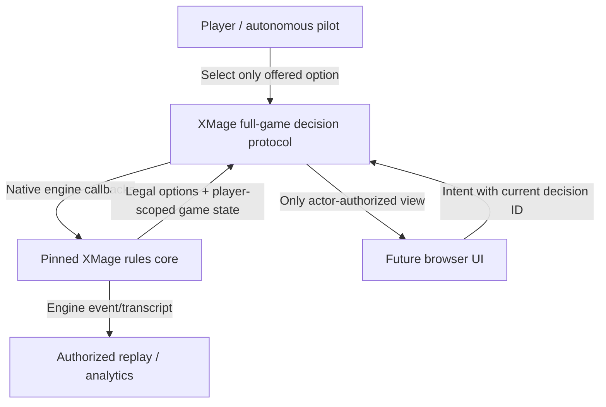

# Playgroup Live vs. pinned XMage — Phase 2: Rules functionality audit

**As of:** 2026-11-08 · **Lab source lock:** `main@e3d88eb957813b59d077e9b94bfbc32ce7fa2412` · **Rules provider:** the XMage commit in `config/rules_engines.json` (do not repin for this audit). **Status:** public feature documentation and Lab implementation inspected; no interactive Playgroup demo or fresh Java full-game test executed.

**Product limits:** Commander Lab **4 players default, never more than 6**. Owner decision and the separate Phase-1 audit are recorded in [PR #1135](https://github.com/moeendres-png/commander-playtest-lab/pull/1135). The current Chulane-only deckbuilding scope is separate. No collection data are required or accessed.

## 1. Important distinction: UI assistance is not rule adjudication

The Playgroup product page says that every Commander mechanic is built in, and one FAQ sentence says every Commander rule is handled automatically. **But the vendor's dedicated comparative documentation explicitly classifies Playgroup Live as “Manual helpers” and says it is not a rules engine; users still make the rule calls.** The latter is the more specific description of the actual responsibility boundary. The Sparring page also explicitly denies an AI opponent and a rules engine.

Therefore:

- **`PG-UI`:** Playgroup advertises a button, visual zone, counter, card search or automated *bookkeeping operation*. This does **not** prove casting legality, priority, targets, layer calculation, automatic triggers or correct game outcome.
- **`PG-VIS`:** server-enforced principal-specific hidden-card visibility is stated by Playgroup; this is an access-control claim, not proof of complete MTG rules adjudication.
- **`PG-MANUAL`:** players remain responsible for legality, triggers, game calls, and resolving disputed interactions.
- **`PG-UNKNOWN`:** the vendor has not documented whether the specific operation is performed or validated automatically; do not infer absence from silence.
- **`XM-CODE`:** the Lab and XMage bridge explicitly implement a corresponding native Rules responsibility, export decision options or apply a gate. **Code support ≠ all cards tested or complete current-HEAD runtime PASS**.
- **`XM-TEST`:** a particular earlier test/measurement is cited; not a substitute for an exact-HEAD new scenario test.
- **`GAP`:** particular engine/bridge integration or output measurement remains unverified or bounded. Avoid fabricated PASS statements.

### Responsibility flow

A viewer must never be allowed to drag a card into an otherwise illegal zone merely because Playgroup's manual table allows the gesture. UI animation and card positioning are display features; state transitions are XMage operations.

## 2. Functional rule matrix

**Playgroup levels:** `UI` means claimed convenience/bookkeeping; `VIS` means server access control; `M` means human rule decision; `?` means undocumented. **XMage levels:** `CODE` means implementation can be identified; `GAP` means behavior or UI projection still requires evidence. This is a functional audit, **not** an executable card-by-card qualification.

| ID | Rule area | Playgroup Live: automatic vs. manual | P evidence | XMage + Lab native responsibility | XM evidence / target |
|---|---|---|---|---|---|
| R01 | Turn/phase/active player | UI highlights active player and provides extra turns; precise automatic phase progression **not established** | UI + ? | Engine maintains turn, phases and acting player; pilot may select only current allowed options | CODE; trace UI mapping |
| R02 | **Priority** | Shared turns and zones, **no verified rules-correct priority/pass sequence**; users make calls | M + ? | Native `Player.priority` routed to blocking `priority` decision; engine decides window | CODE; 4P/6P ordering test |
| R03 | **Stack order/resolution** | Dedicated **reorderable** Stack zone; **not an engine that resolves spells** | UI + M | Engine owns stack, responses, countering, spell/ability resolution | CODE; multi-item LIFO test |
| R04 | **Triggered abilities** | Action/event log can help remember missed triggers; no proof every trigger fires automatically | UI + M | Native triggered abilities and `trigger_order` choice from XMage | CODE; simultaneous triggers / APNAP test |
| R05 | Mana sources/payment | Users manipulate cards, tap and counters; automatic payment and valid sources **not confirmed** | UI + ? | Native `mana_payment`; castable action options; costs enforced by engine | CODE; native optional-mana edge cases |
| R06 | Spell casting timing | Drag-to-Stack/board available; priority/timing legality not independently enforced | UI + M | XMage checks cast timing, payability, targeting; failed action must fail closed | CODE + historical repair (F-35) |
| R07 | Legal targets | User-drawn targeting arrows; no fully validated target enumeration | UI + M | Engine provides offered `target`, `target_amount` decision domain | CODE; hexproof/protection test |
| R08 | Modes and modal spells | Card actions and stack helper; legal mode selection unproven | UI + ? | XMage native `mode` choice, with previously repaired invalid-mode exposure | CODE + historical F-35 |
| R09 | Replacement / prevention | Manual card-rule decisions and markers; automation **unknown** | M + ? | Native `replacement_effect` choice; Magic replacement resolution | CODE; replacement-choice tests |
| R10 | Continuous effects/layers | Temporary P/T override markers supported; automatic layer resolution not documented | UI + M | Engine calculates ongoing effects/layers and SBA | CODE; layer ordering test |
| R11 | State-based actions | Life and counters tracked; automatic legend rule, lethal damage, and all SBA not established | UI + ? | Native state-based actions, game termination and legality | CODE; death/legend tests |
| R12 | Attacking/blocking | Card positioning/target arrows; attack and block legality remains a player call | UI + M | Native `declare_attacker`, `declare_blocker` and combat damage choices | CODE; multiplayer defender cases |
| R13 | Damage/poison/life/rad | HUD counters for life, poison, rad; auto-mill reminder for rad claimed | UI | Native damage, poison and life effects, win/loss processing | CODE; 10-poison & rad tests |
| R14 | **Commander damage** | Separate commander-damage bookkeeping | UI | Native commander-damage tracking and 21-damage loss condition | CODE; 2 enemy commanders to same player |
| R15 | **Commander tax** | Commander-tax counter/helper claimed; whether legal mana spend is verified **not** | UI + M | XMage applies additional cost; Lab pilot has a historical tax-view fix (not a Rules override) | CODE + historical #1040 |
| R16 | Command zone/zone change | Visible Command Zone, move/return card manually | UI + M | Engine owns commander zone options and zone-change replacement/SBA semantics | CODE; bounced vs. exiled commander |
| R17 | Partners and deck construction | Partners and Commander deck upload supported; independent color identity validation not shown | UI + ? | Lab 100-card, singleton, commander color identity checks; XMage imports deck | CODE; partner + odd color card |
| R18 | Multiplayer mulligan | Mulligan phase/buttons, friendly lobby mulligan switch | UI + M | Native London mulligan contract: first free mulligan 3–6P, not 2P | CODE; 2P vs. 4P vs. 6P |
| R19 | **Scry** | One-click configurable count, private library view and rearrangement | UI + VIS | Native engine decides seen set, ordering and resulting zone | CODE; scry with trigger |
| R20 | **Surveil** | One-click look/move for library top cards | UI + VIS | Native engine chooses graveyard/library placement and fires zone-change triggers | CODE; death/discard triggers check |
| R21 | **Cascade/Discover** | Dedicated assist; mana-value checks advertised | UI + M | Native XMage effect, exile/search/cast timing and legality | CODE; split/adventure cost edge tests |
| R22 | Tutor/fetch/search | Search whole library, shuffle, reveal-until-type UI | UI + VIS | Engine selects searchable eligible cards and visibility windows; random shuffle native | CODE; hidden-leak tests |
| R23 | Reveal/look to specific player | Choose one player to show a face-down exile card | UI + VIS | Principal-scoped look/reveal grants, including controlling another player (CR 723) | CODE; actor-only, spectator negative test |
| R24 | Morph/disguise/manifest | Face-down 2/2 card UI and concealment; disguise ward reminder | UI + VIS | XMage native face-down semantics, ward, identity/visibility; not all niche interactions independently audited here | CODE + GAP; morph reveal/ward test |
| R25 | Foretell | Face-down tagged Exile pile and cast-from-exile helper | UI + VIS | Engine determines legal permission, cost, timing and visibility | CODE; opponent must not see identity |
| R26 | Impulse/exile piles | Organize groups (Jeska's Will/Ixhel) and show permitted known cards | UI + VIS | Native engine controls cast permission, duration and visibility | CODE; expires at turn end |
| R27 | Tokens/copies | Token/card markers and placement supported | UI | XMage owns token creation/copy characteristics, attachments and SBA | CODE; Chulane Clues/Treasures |
| R28 | +1/+1, keyword, P/T counters | One-click counters and manual P/T overrides | UI | Native counters, power/toughness, layers and interactions | CODE; proliferate and zero-toughness |
| R29 | Tap, transform, flip, phase | Convenient direct actions, shortcuts, visual state | UI | Engine determines which tap, transform, and phase transitions are legal | CODE; phasing with attachment |
| R30 | Aura/equipment attach | Dedicated attachment shelf and drag UX | UI + M | Engine checks legal targets and attach restrictions | CODE; illegal aura attachment |
| R31 | Planeswalkers, Sagas, room cards | Starting counters, emblems, rooms/doors UI | UI + ? | Native card implementation is authoritative; specific cards need exact-pin support and tests | CODE + GAP; Saga timing test |
| R32 | Player concession / exit | Host kick, handoff on disconnect; rule-semantic elimination not confirmed | UI + M | XMage tracks eliminated players, their permanents and turn control (CR 800.4); bridge handles cancelled decisions | CODE; priority exit tests |
| R33 | Randomness/shuffle | Rolls/dice server-based; shuffle on library UI | UI (server RNG claimed) | XMage Rules-RNG seeded before start; engine shuffles and chooses random outcomes | CODE; seeded twin test |
| R34 | **Undo** | Undo any action, particularly solo play | UI | Productive full-game bridge disables free turn rollback; no arbitrary legality-bypassing state rewinds | CODE; test rejected stale action |
| R35 | **Hidden opponent hand/library** | Server hides hidden zones (not merely a card-back overlay) | VIS | Native redactor plus per-decision actor-scope audit; foreign hands/mana pools fail closed | CODE + earlier unit tests |
| R36 | Replay and spectator | Shared public-game spectate, postgame **full reveal** replays | UI + VIS | Transcripts exist; audience-specific authorization must be designed; Replay `TapeGameManifest` is still max **5P** | CODE + GAP at 6P |
| R37 | Game outcome | Players can jointly select winner/draw in postgame rating flow | UI + M | XMage produces actual winner/terminal result and requires graceful shutdown | CODE; terminal 4P full game |
| R38 | **Solo Sparring** | Randomized stat-based counters/removal/wipes; ~120 curated answers, acceptance decided by human | UI + M, **NO ENGINE/AI** | Our pilot must decide from real XMage legal options and full opponent decks | CODE; no fake cards/answers |

### Where Playgroup's documentation is ambiguous

1. Its September 2026 product FAQ says all Commander rules are automatic; the **specific June–October 2026 self-comparison** says rule enforcement is **manual helpers**. Treat the product-FAQ sentence as marketing shorthand for bookkeeping, **not proof** of every Magic rule being enforced.
2. Playgroup can automatically operate Scry, Surveil, Cascade/Discover UIs and maintain hidden zones. That does not prove that every triggered effect, priority window or replacement effect is enforced. In the UI, a card may be legally or illegally moved by its player.
3. Server-side hidden visibility and server-side dice RNG are stronger than purely manual trust; but they protect confidentiality and randomness, **not every game rule**.
4. Playgroup Sparring explicitly says it has no AI and no Rules Engine; do not extrapolate this denial to mean the entire platform has zero helpful programmatic effects.

## 3. Lab implementation evidence (exact paths at source lock)

### Rules authority and options

- `engine-bridge/src/main/java/org/commanderlab/xmage/XmageFullGameSession.java`: native `GameCommanderImpl` game, 2–6 player bound, mulligan difference 2P/3–6P, per-game RNG, rollback disabled.
- `engine-bridge/src/main/java/org/commanderlab/xmage/XmageFullGameDecisionController.java`: game thread blocks on native decision, publishes `legal_options`, refuses unsupported classes and arbitrary selections, no fallback.
- `engine-bridge/src/main/java/org/commanderlab/xmage/XmageFullGameActionProjection.java`: maps native options to IDs; never fabricates target, mana, mode or legal action domains.
- `engine-bridge/src/main/java/org/commanderlab/xmage/XmageFullGameStateRedactor.java`: engine-controlled owner/permitted look/reveal, scoped decisions, opponent private zones.
- `src/commander_lab/engine/rules/full_game.py`: `XmageFullGameRunner`, 2–6P, `audit_actor_scoped_frame`, deck legality gates, deterministic game-over checks.
- `artifacts/xmage-full-game/DECISION_CLASS_INVENTORY.json`: enumerated priority, target, target_amount, choice, mode, replacement_effect, trigger_order, mana_payment, mulligan, declare_attacker, declare_blocker, announce_x, amount, multi_amount, pile etc. **Historical inventory; current bridge source is the higher authority.**
- `tests/unit/test_full_game_hidden_audit.py`: actor-scoped privacy negative tests. **Previously committed tests, not freshly executed in Phase 2.**
- `docs/multiplayer_findings/F-35_OFFERED_OPTIONS_THAT_ABORT_THE_GAME.md`: historical illegal-option defects on modes and mana, repaired with native checks. Never claim the generic rule that every offered option always executes successfully solely from available code.
- `docs/performance/PILOT_COMMANDER_TAX_2026-10-30.md`: Lab pilot previously mispriced recast tax while engine could execute the legal move; the pilot's evaluation was corrected. This proves **pilot strategy can be wrong even when Rules Core is correct**.
- `src/commander_lab/semantic_replay/tape.py`: selected replay manifest/seat contracts bound to 2–5P. **Do not claim 6P replay fully supported.**
- `config/rules_engines.json`: canonical pinned engine identity; this document must not hardcode/modify the pin.

### Known evidence caveats

- Source-code implementations and unit tests are evidence of *intended behavior and constraints*, not a fresh 2026-11-08 cross-platform functional parity run.
- The bridge's external decision classes can expose previously unknown card-specific callbacks; fail-closed rejection is desired until qualified, not a reason to auto-pass.
- The previously reported Chulane `READY` state is only card-facts and pilot-readiness; it is not complete Rules, combo or coverage certification.
- All future experiments must preserve 4P default and 6P hard maximum. A 6P smoke is not automatically equivalent to a completed game or six-player replay proof.

## 4. Prioritized difference-to-implementation decisions

| Priority | Area | Recommended UI function | Rules authority / nonnegotiable gate |
|---|---|---|---|
| P0 | **Priority + stack** | Visible queue, who has priority, explicit Pass, stack preview and resolve trace | Only decision IDs published by XMage; no draggable stack reorder |
| P0 | **Opponent hidden information** | Actor-scoped hand, face-down card back, authorized reveals and look-at-top | Full redaction before network; 4P/6P negative leakage tests |
| P0 | **Mana/casting/targets** | Grey out options that XMage does not offer; show real costs, choices and targets | Native action domain must remain solely XMage; no client-side guessed castability |
| P0 | **Commanders + losses** | Commander damage per source, command-zone cast history/tax, legal redirection choices | Native commander-zone, tax, combat, 21 damage and state-based action |
| P0 | **Triggers/replacements** | Nonblocking clear decision dialogs and simultaneous-trigger ordering UI | Native trigger and replacement option sets; no auto-dismiss |
| P1 | **Library helpers** | Scry/Surveil/reveal/search dialogs with speed and keyboard controls | Engine-chosen eligible cards, per-principal visibility and seeded RNG |
| P1 | **Combat and crowded boards** | Attack/block target arrows, scalable Chulane-token stacks, grouping | Native legal declarations and damage assignment |
| P1 | **Replay / analytics** | Authorized per-seat timeline, cast opportunities and turns-held instrumentation | Explicit replay entitlements; **no 6P proof until replay contract extends** |
| P2 | **Fancy WebGL/game effects** | Animated cards, GPU batch rendering, polished transitions | Measure 4P/6P CPU/RAM/GPU needs before choosing stack |
| EXCLUDE | Freeform manual controls | Arbitrary spell cast/resolve, shuffle manipulation or rollback while XMage game is live | Violates sole Rules authority |
| EXCLUDE | 7+/8P | Not in UI, API or jobs | Permanent Owner maximum six |

**Not recommended:** implementing Playgroup's manual “just move the card” mechanic as a second game rules path. For a separate analysis/practice canvas, simulated game evidence must never be confused with live engine evidence.

## 5. High-value test matrix — proposed, NOT RUN

All tests use no owner collection data. Test decks are isolated public/local fixtures. Tests should be run on a pinned XMage build and capture exact Lab HEAD, engine SHA, scenarios, seed, terminal status, fail-closed error messages, privacy checks and trace digests. *No tests below are claimed as executed by this audit.*

| Test ID | Scenario | Required observable behavior | Grade |
|---|---|---|---|
| F01 | 4P counterspell on stack: player A casts creature, B responds, C responds | Exact native priority rotation, LIFO resolution, correct terminal stack | Blocker P0 |
| F02 | 4P same-time triggers from two controllers | Correct automatic trigger registration, ordered options/APNAP and resolution | Blocker P0 |
| F03 | Unpayable signet/ability and modal spell with illegal targets | Not offered as castable; no abort/rewrite/fallback | Blocker P0 |
| F04 | Creature copied under alternate control | Correct owner/controller, legal targets and actor visibility | Blocker P0 |
| F05 | Commander recast from command zone at 0/+2/+4, redirected after death/exile | Correct mana payment, commander-zone choices and tax history | Blocker P0 |
| F06 | Commander damage: two different opposing commanders strike same player | Independent source tracking; loss only on one source reaching 21 | Blocker P0 |
| F07 | Hidden hand + hidden library top revealed only to controller | Other players/spectators receive no identity; look grant expires after decision | Blocker P0 |
| F08 | Morph/disguise face-down then legal reveal, ward and control-change | No identity leak, native costs/abilities and correct choices | Blocker P0 |
| F09 | Foretell/impulse cards with expiry and reveal-to-one | Timing and visibility rights stay native; unauthorized access denied | Blocker P0 |
| F10 | Scry 3 / Surveil 3 / Cascade / Discover with split or Adventure face | Proper named identities, cost/mana-value, exile/yard/library and trigger events | P1 |
| F11 | Chulane casts Whitemane Lion; ETB bounce and Chulane draw/land sequence | Correct trigger timing and independent player choices; no fictional infinite loop | P0 Chulane |
| F12 | Chulane + Academy Manufactor + clue/treasure token generation | Replacement choices, correct number and kind of tokens, limits | P0 Chulane |
| F13 | Chulane + Tatyova/Felidar Retreat + extra land drop | Trigger order, draw, landfall tokens and lifegain; no doubled event | P1 Chulane |
| F14 | Chulane + Psychosis Crawler draws while multiple enemies remain | Each opponent independently loses correct life after actual draws | P1 Chulane |
| F15 | Chulane + Mechanized Production controlling eight same-name artifacts | At-upkeep trigger, condition checked by engine, outcome only when legally satisfied | P1 Chulane |
| F16 | Chulane against removal/board wipe with protection | Real priority windows, legal response and zone-change consequences | P0 Chulane |
| F17 | 4P game with a player leaving during decision/stack/combat | Engine cancels/continues correctly, no stale seat/private info, correct survivors | P0 |
| F18 | 6P full game with large token battlefield | Engine terminal/status, peak memory, decision count, no hang; never exceed six | P1, separately qualified |
| F19 | 4P spectator and replay; 6P replay | Live viewer never sees hidden cards; postgame reveal requires access policy; 6P gap explicit | P0 privacy |
| F20 | Invalid UI proposal (stale ID, out-of-turn option, fabricated target) | Bridge rejects without state mutation; fail closed | P0 security |
| F21 | Free Undo attempted during live XMage game | Refused unless a future explicit engine-native qualified rollback exists | P0 correctness |
| F22 | 7/8/10 players offered to new game endpoints | Rejected before allocating JVM/resources | P0 Owner cap |

## 6. Preliminary audit verdict

**`PHASE2_PUBLIC_FUNCTIONAL_MATRIX = COMPLETE`** as an evidence-classified comparison of publicly documented Playgroup helpers against inspected Lab source surfaces.

**`PLAYGROUP_RULES_ENGINE = NOT_DEMONSTRATED`**: the vendor self-describes the product as a *manual table* despite an ambiguous FAQ marketing statement. Hidden-state enforcement is a useful technical mechanism, not Magic Rules parity.

**`XMAGE_BRIDGE_RULES_RESPONSIBILITY = CODE_DERIVED`**: code demonstrates native authoritative options and principal-scoped state. **`FULL_GAME_PARITY_FOR_ALL_ROWS = UNKNOWN`**, no new tests performed.

**`OWNER_MAX_PLAYERS = 6`** for every new simulation and UI, without any 7+/8P stretch. Current specific replay contract remains only 2–5P; classify 6P replay **GAP**.

## Sources and reproducibility

**Playgroup primary sources (public pages, retrieved November 2026):**
- Feature catalog: https://playgroup.gg/playgroup-live/features
- Full Playgroup Live page + conflicting “automatic rules” FAQ: https://playgroup.gg/playgroup-live
- Explicit classification *manual helpers vs automatic rules-engine*: https://playgroup.gg/playgroup-live/play-commander-online
- Manual tabletop statement: https://playgroup.gg/playgroup-live/vs-tabletop-simulator
- July 10 update: https://playgroup.gg/posts/99-playgroup-live-two-months-of-updates
- Sparring's no-Rules/no-AI admission: https://playgroup.gg/playgroup-live/how-sparring-works

**Lab technical sources (public pinned source-lock):**
- https://github.com/moeendres-png/commander-playtest-lab/tree/e3d88eb957813b59d077e9b94bfbc32ce7fa2412
- `engine-bridge/src/main/java/org/commanderlab/xmage/XmageFullGameDecisionController.java`
- `engine-bridge/src/main/java/org/commanderlab/xmage/XmageFullGameActionProjection.java`
- `engine-bridge/src/main/java/org/commanderlab/xmage/XmageFullGameStateRedactor.java`
- `engine-bridge/src/main/java/org/commanderlab/xmage/XmageFullGameSession.java`
- `src/commander_lab/engine/rules/full_game.py`
- `src/commander_lab/semantic_replay/tape.py`
- `artifacts/xmage-full-game/DECISION_CLASS_INVENTORY.json` (historical)
- `tests/unit/test_full_game_hidden_audit.py`
- `docs/multiplayer_findings/F-35_OFFERED_OPTIONS_THAT_ABORT_THE_GAME.md`
- `docs/performance/PILOT_COMMANDER_TAX_2026-10-30.md`
- `config/rules_engines.json` (sole pin authority)

**Privacy and rights:** No `data/collections/**` read; no personal decks sent to Playgroup; no copying Playgroup proprietary code/assets. Any API-based aggregation study is separately reviewed.
