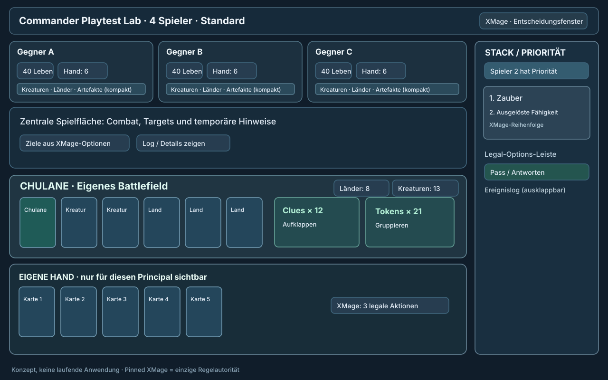
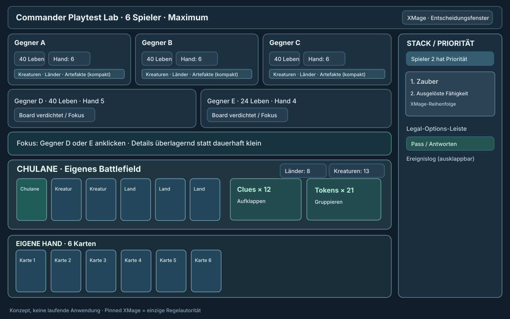
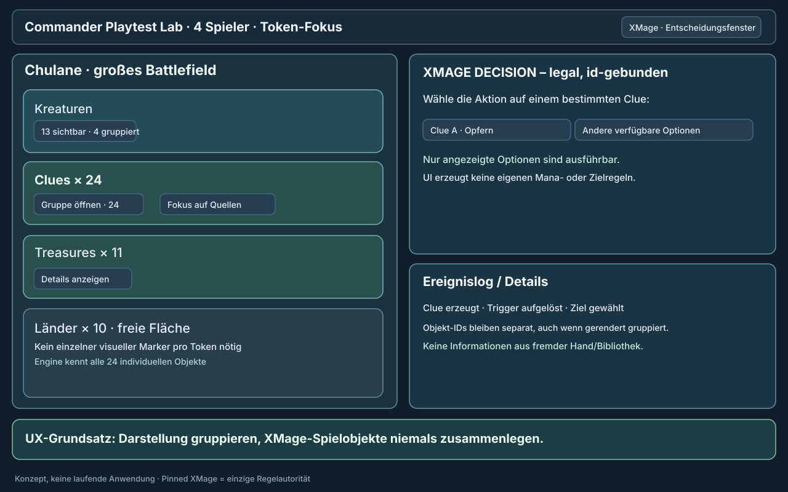

# Playgroup Live — Phase 4: Battlefield UX audit and screen concepts

**Source lock:** `commander-playtest-lab main@e3d88eb957813b59d077e9b94bfbc32ce7fa2412` (2026-11-08) · **Scope:** documented public Playgroup features, UI interaction patterns, existing XMage bridge contract, proposed desktop/tablet/phone design, 4P and 6P screens, Chulane crowded-board controls and **static-only** 8P comparison.

> **Evidence levels:** `VENDOR_DOCUMENTED` = feature described by Playgroup itself, **not** a hands-on test. `LAB_CODE_DERIVED` = verified Java/Python file contract, **not** implemented browser UI. `DESIGN_PROPOSAL` = new specification awaiting implementation and usability/runtime validation. `NOT_TESTED` = no interactive Playgroup session or real browser/game UI test executed in this audit.

**Current owner constraints:** Chulane is the sole active owner deckbuilding focus (PR #1134 remains independent); **4 players standard, 6 players production maximum, no 7+/8P simulator/UI** (Phase-1 PR #1135). The user's later request to compare 8P is accommodated **only in a visibly unsupported static concept**. The authority for all rules, decisions, hidden cards and randomness remains the pinned XMage engine. **No collection files under `data/collections/**` were read or accessed.** No real player-facing browser UI exists as a result of this documentation PR.

## A. Original screen wireframes

The SVG wireframes are newly drawn original diagrams with fictional player labels and abstract rectangles, not copyrighted Playgroup screenshots and not browser implementation.

| Concept | Artwork | Status | Objective |
|---|---|---|---|
| 4P desktop, **default** | [Open SVG](wireframes/phase4-4p-desktop.svg) | DESIGN_PROPOSAL | Three opponents in upper strip; own Battlefield and hand largest; stack and decision sidebar always visible |
| 6P desktop, **maximum** | [Open SVG](wireframes/phase4-6p-compact.svg) | DESIGN_PROPOSAL | Five opponents condensed in two rows; player selection zooms one seat without losing own state |
| Chulane token/crowded-board focus | [Open SVG](wireframes/phase4-token-detail.svg) | DESIGN_PROPOSAL | Group Clues/Treasures/Creatures visually while retaining native XMage object identities |
| 8P **static research only** | [Open SVG](wireframes/phase4-8p-static-study.svg) | RESEARCH_ONLY | Demonstrate legibility degradation; **not** game-start, admission, action, server, comparison, or product specification |

### 4P desktop preview


### 6P desktop preview


### Chulane crowding countermeasure


The 8P wireframe deliberately displays an **unsupported** banner and disabled gameplay. Do not link the mockup to a start button or silently broaden the existing six-seat backend cap.

## B. Playgroup's documented user-experience inventory

| Function | Actual vendor claim | UX evaluation for our rules-first simulator | Evidence |
|---|---|---|---|
| Battlefield zones | Hand, battlefield, graveyard, exile, library, command zone, shared Stack; rearrangement within structured zones | **ADOPT pattern**; own zone layout, no manual rule-changing state moves | VENDOR_DOCUMENTED |
| Drag/drop/target arrows | Cards move between zones; live drag previews and target-arrow visualization | **ADAPT:** gesture selects native legal action/target only; display optimistic drag *preview*, no optimistic rule-state commit | VENDOR_DOCUMENTED |
| Multi-select | Marquee-select many permanents for tapping/moving/token actions | **ADAPT:** visual selection/grouping only; a batch operation can submit multiple engine decisions only through authoritative sequence, never a fabricated atomic magic action | VENDOR_DOCUMENTED |
| Tap, flip, transform, phase | One-click or keyboard shortcuts | **ADAPT:** available only when XMage offers corresponding action; mark states without altering engine | VENDOR_DOCUMENTED |
| Equipment & Auras | Separate attachment shelf visually near source creature | **ADOPT visually**; native attachment target/protection restrictions | VENDOR_DOCUMENTED |
| Counters and markers | Keyword counters, P/T overrides, token piles, life/poison/rad, monarchy etc. | **ADOPT viewing; ADAPT changes:** no manual +1/+1/P/T alteration during canonical XMage game | VENDOR_DOCUMENTED |
| Hidden card play | Server hides Morph/Disguise/Manifest/Foretell and selective reveals | **REQUIRED** seat-scoped projections; do not trust CSS-hidden card art or client redaction | VENDOR_DOCUMENTED |
| Library helpers | Quick Scry, Surveil, Look, Tutor/Fetch, Cascade/Discover; reorder/reveal | **ADAPT:** map to exact XMage temporary reveal/order/choice decisions; never client-side shuffle or arbitrary look | VENDOR_DOCUMENTED |
| Stack | Shared visible Stack | **ADOPT view only**; do not offer arbitrary reorder, manual counter or resolve | VENDOR_DOCUMENTED |
| Undo | Free last-action undo, especially solo | **EXCLUDE** from live XMage unless a separately authorized, tested native rollback contract exists | VENDOR_DOCUMENTED |
| Events/replays | Every play event logged with card preview, spectating and postgame replay | **ADOPT gated** actor-scoped log; 6P replay manifest presently 2–5 so not a feature pass | VENDOR_DOCUMENTED + LAB_CODE_DERIVED |
| Zoom/card languages | Card size slider, hover/inspect, translated printing per player | **ADOPT inspect pattern**; translation metadata and card imagery require separate image/licensing checks | VENDOR_DOCUMENTED |
| Animation/performance | Shadows, reduced motion, smaller rendering defaults; large board improvements | **ADOPT graceful degradation**; don't presuppose WebGL over DOM/SVG/Canvas | VENDOR_DOCUMENTED |
| Keyboard | T tap, F flip, G graveyard, H hand, E exile, S shuffle, C counter, I inspect; ? shortcuts help; Ctrl+Space hotkey mode | **ADAPT shortcuts** to native options or inspection, not free moves/shuffle; add explicit Pass/Confirm bound to current decision | VENDOR_DOCUMENTED |
| Touch | Landscape tablet with long-press, tap-to-preview, pinch-zoom; phone seat-switching as documented elsewhere | **ADAPT** responsive one-seat/focus view. Not verified against live board | VENDOR_DOCUMENTED |

**Source caution:** Playgroup's 2025 `Playgroup 4.0.0` post refers to the earlier tracker/life-counter app, **not the same Playgroup Live web UI**; its 4/5/6-player alternative table layouts must **not** be treated as direct evidence of Live's precise layout.

Primary Playgroup documentation:
- https://playgroup.gg/playgroup-live
- https://playgroup.gg/playgroup-live/features
- https://playgroup.gg/playgroup-live/vs-tabletop-simulator
- https://playgroup.gg/posts/99-playgroup-live-two-months-of-updates (2026-07-10)
- https://playgroup.gg/posts/93-playgroup-4-0-0 (tracker app, provenance only)

## C. UX principles and minimum screen information

1. **Your hand and Battlefield take priority.** Own hand and own targets stay legible without zoom on a normal desktop. The active opponent is second; other opponents are summaries until selected.
2. **Priority is the main call to action.** Always display *whose* decision it is, the native decision class, the current stack, and the exact legal actions. The actor must not have to guess whether clicking a card is legal.
3. **Never leak hidden data.** Every seat receives its own server-side redacted view. Other hands are counts and card backs only; personal face-down identities are shown only with native permission. Redaction precedes serialization.
4. **Large boards reduce visual duplication, not game objects.** `Clue × 24` is one rendered group representing 24 distinct XMage objects; when one is the target/source, disclose the exact object label/ID and offered operation in a focused drawer.
5. **State changes have receipts.** No local authoritative drop/untap/tap. Pending action is visually reversible; after XMage acknowledgement, reconcile with the newly redacted game state or show a fail-closed error.
6. **4P defaults; 6P is a deliberate dense layout.** No responsive feature may advertise a 7+/8P game. 8P here is an accessibility/comparison thought experiment only.
7. **Replay is not a bypass for spectator permissions.** Default live spectator is public-only and must never receive postgame private reveals without a separate explicitly authorized lifecycle.

### Proposed HUD content (DESIGN_PROPOSAL)

- Topbar: game ID/reference hash abbreviated, round/phase, current active seat, current priority seat, pause status if a verified orchestration pause exists, real engine `status`.
- Each opponent HUD: commander name, current life, commander damage received per originating commander, hand/library counts, mana only if public, graveyard/exile/command inspection, flags/poison/monarch.
- Own HUD: own visible zones, own resources, hand, current native choices, commander status and cost/tax if exported by native source.
- Right dock: Stack entries in actual engine order, target context, player priority, current offer including prompt/selection min/max; second tab for event log; details inspector on focus.
- Board: permanent art or accessible placeholder, tapped/transform/phased states, damage and counters, attachment link, token quantities, searchable in-view card names **only where public/authorized**.
- Card inspector: public Oracle/printing/card rules detail, current engine-visible stats, action **only if offered** and only for the current actor.
- Footer: own hand, pass or explicit choice selection; never place an Undo shortcut in canonical live play.

## D. Screen and responsive layout specification

All dimensions below are **proposed design constraints**, not Playgroup measurements.

| Mode | Target viewport | Proposed composition | Unavoidable trade-off |
|---|---|---|---|
| 4P desktop | 1440×900; minimum 1200 CSS px width | Three opponent panels across top; central battle lane; own Battlefield and hand dominate bottom; right Stack dock | Long card names and many permanents require card grouping |
| 6P desktop | 1440×900; 1200+ CSS px | Five opponent condensed strips (3 top + 2 second), own Battlefield/hand still protected; right Stack dock; click opponent for expanded modal | Can't display six full-size Battlefields simultaneously |
| Tablet landscape | 768–1199 CSS px, landscape recommended | Own Battlefield + own hand, one active opponent enlarged, remaining opponents in compact seat strip, Stack as collapsible drawer | Requires focus/seat switching rather than shrinking all card text |
| Phone landscape | under 768 CSS px | Single focused seat, pinned own hand controls, Stack/priority in bottom sheet, actor seat selector | Accessibility and touch targets matter more than full-table simultaneity |
| 8P | no operational viewport | Static diagram for research only | **Not a supported game, no UI routes or session contracts** |

**Navigation:** selecting an opponent changes focus **without** switching the principal: you still cannot read that opponent's hand. The focus mechanism only changes the presentation of the redacted view. A controlled-turn effect follows native `decidingPlayer` authorization, not UI seat selection.

## E. Concrete interaction contract vs. existing bridge

**Current technical inputs (LAB_CODE_DERIVED):**
- `XmageFullGameDecisionController.request` emits `decision_id`, `decision_class`, `actor_id`, `prompt`, `minimum_selections`, `maximum_selections`, `legal_options`, `source_object`, `pilot_state`, `timeout_millis` and context from native XMage callbacks. Actor can differ from the player controlled under CR 723.
- `XmageFullGameActionProjection` constructs opaque `action_id` bound to the current native `decision_id` and exact `option_id`; arbitrary `target_ids`/`selected_modes` supplied by callers are forbidden.
- `XmageFullGameStateRedactor` is authoritative for per-principal hidden-zone entitlements (including temporary library look windows and controlled turns).
- `src/commander_lab/engine/rules/full_game.py` includes a hidden-information audit, decision and result models.
- **Not implemented by this audit:** a real authenticated browser gateway with per-player session authentication, WebSocket/SSE fanout, human-input bridge controller, browser choice submission, event streaming, card artwork rendering, or live spectator authorization. Any implementation must preserve out-of-process pilot isolation, not invent a new Rules Core or leak raw engine state.

**Proposed adapter boundaries (not new authoritative rules):**

```text
backend -> browser, principal-scoped:
  session { game_id, player_count<=6, viewer_seat, live_status }
  public_view { turn, phase, players[], stack[], public_events[] }
  private_view { own_hand[], allowed_library_looks[], authorized_face_down[] }
  pending_decision? { decision_id, offset, actor_id, class, prompt,
                      legal_options[], selection_bounds, timeout_ms }
browser -> backend:
  choose { decision_id, offset, offered_option_id(s), native_numeric_choice? }
backend -> browser:
  accepted { game_revision, freshly redacted view }
  OR rejected { sanitized_reason, latest_view }
```

This is a **future gateway proposal**, not a current wire schema. Server must bind user identity to principal authorization, validate decision revision and native option membership, and return no private raw traces. Numeric choices and ordered selections must respect the existing native schema. No untrusted browser-provided object/name/text may substitute for an option.

### Gesture scenarios

| Gesture | Proposed browser response | XMage authority / rejection |
|---|---|---|
| Click own untapped creature | Show detail + offered operations | Tap only when a legal native action is offered |
| Drag card to battlefield | Display a ghost preview and offered cast/put choices | Submit current offered action, do not mutate state until engine confirms |
| Select target arrow | Arrow originates at exact object, lights only native target choices | Reject targets not in current decision |
| Move creature to graveyard with `G` | Show context menu or open current XMage allowed action | No direct unsupported move, no bypassed destroy/sacrifice |
| `S` shuffle | Open current permitted engine choice or inspect help | Never locally shuffle public/hidden deck |
| Tap multiple lands | Select visual group, request one-by-one legal actions | Multiple actions ≠ fabricated atomic transaction |
| Open foretell / scry | Show native permitted identities in temporary overlay | Hide immediately after decision permission expires |
| Select `Clues ×24` | Expand to 24 distinct public object references (virtual list), card detail | UI group is not a single native object; exact choice remains native |
| Click opponent seat | Expand public board and graveyard | No access to opponent hand or hidden library |
| Pass priority | Submit current native pass option for current actor | Disabled for every other principal; stale decisions rejected |
| Undo / manually set life | Show unavailable-in-live explanation | No production path to rewrite engine result |

### Shortcuts (proposal, not Playgroup's exact mapping)

| Proposed shortcut | Scope | Guard |
|---|---|---|
| `I` / `Enter` | Inspect selected card / confirm highlighted offered option | Inspection may work without decision; Enter requires current decision |
| `Space` | **Pass priority only if** native pass is offered | Never synthetic pass |
| `T` | Open native Tap/Activate action for selected permanent | No direct tap mutation |
| `F` | Inspect transform/flip options | Only native offered action |
| `G`, `H`, `E` | Context action searches for graveyard/hand/exile | Disabled when no native action exists |
| `C` | Inspect counters / legal effect options | No arbitrary counter changes |
| `?` | Accessible shortcut panel | Always available, not an XMage action |
| `Escape` | Close focus/modal or cancel **unsubmitted** browser choice | Does not undo submitted XMage decision |

**Conflict-resolution:** keyboard focus in text fields disables gameplay shortcuts; screen-reader actions use named buttons, not only hotkeys. Touch equivalents use long-press/selection sheets and targets >=44×44 CSS px where practical.

## F. Animation, zoom and legibility

**Animations are cosmetic, event-driven and optional.** Visual feedback should be keyed to confirmed state transitions/sequence IDs, not to untrusted local predictions.

- On cast/trigger: brief stack-entry highlight. When 20+ triggers appear, aggregate animation with `20 triggers resolved` + a detailed event log; **never coalesce XMage resolution semantics**.
- Tap/Untap/transform/phase: quick state transition, `prefers-reduced-motion` eliminates movement.
- Life/commander damage: text and value change; color alone never conveys damage.
- Hover/focus: full readable card preview including current printed face, ability text and authorized state.
- Zoom controls: wheel/pinch for board transform, card preview independent of board zoom, `Reset view` and keyboard `+`/`-` controls; keep focus and Stack usable when zoomed.
- Performance degradation order: disable shadows -> disable decorative transitions -> virtualize off-screen opponent permanents -> simplify attachments/stack arrows -> collapse opponent boards **without hiding their public state from inspect**. Never disable Rules calls or drop events for performance.

### Proposed performance/accessibility acceptance (targets, NOT MEASUREMENTS)

- At 1440×900 in 4P and 6P, visible selected card name, tapped state, chosen legal option, acting principal, stack top and public life totals are distinguishable.
- Long card name tooltips do not cover the current choice controls; card art has accessible card name and safe text fallback.
- Input targets ~44 CSS px for touch controls; full keyboard focus outline, shortcut help, readable text contrast, high-contrast mode.
- Target to verify **p95 UI interaction feedback <100 ms** for purely local highlighting on benchmark hardware; **not** a limit on XMage decision resolution time.
- Measure actual p50/p95 FPS and memory at 4P/6P with 5/15/40 permanents per seat plus dense Clues. Do not infer these from Playgroup's optimization posts.
- No frame stutter should cause a native decision to be sent twice; client may show a spinner while the single server-authorized action is in-flight.

## G. Chulane stress and user-path test plan — NOT EXECUTED

| ID | UX scenario | Test oracle / acceptance |
|---|---|---|
| UX-01 | 4P layout with 1 owner + 3 opponents, 1440×900 | Own hand and board largest; Stack visible; all HUDs readable |
| UX-02 | 6P layout, five opponents, live priority changes | No disappearing seat; selected opponent focus not permission escalation |
| UX-03 | 4P Chulane with 15 creatures, 25 Clues, 10 Treasures | Group counts exact; individual native object IDs selectable; controls readable |
| UX-04 | Same dense field with 6P | Pinned own hand/Stack, opponent summaries, no unbounded number of DOM cards |
| UX-05 | Chulane casts Whitemane Lion and activates Chulane | Engine trigger order, bounce/draw choices, correct visual receipt; no phantom option |
| UX-06 | Several simultaneous ETB/landfall triggers | Stack top remains identifiable; animation may aggregate, transcript may not |
| UX-07 | Rapid target selection against five opponents | Offered native target IDs only; no stale target after priority shifts |
| UX-08 | Reveal or scry private library cards | Only current permitted viewer receives identities; post-decision overlays removed |
| UX-09 | Opponent controls our turn under native effects | Actual deciding principal receives choices; player labels remain unambiguous |
| UX-10 | Morph / face-down exile / spectators | No private name/image/tooltip/cache/event leak |
| UX-11 | Key shortcuts, slow network, stale decision or double-click | No unauthorized move, duplicate apply or automatic fallback |
| UX-12 | Reduced motion, keyboard-only, screen reader and color vision | Every significant state is communicated without color or animation alone |
| UX-13 | Tablet and phone landscape layouts | Own hand accessible; seat strip and Stack drawer reachable via touch |
| UX-14 | 7/8 player new session request | Product API/UI rejects **before** allocating engine resources |
| UX-15 | 6P replay request on current 2–5 manifest | Explicit **not qualified**, no fake successful replay |
| UX-16 | Large trigger loop with thousands of entries | Virtualized Stack list, bounded DOM work, preserve all exact engine events |
| UX-17 | Game ends with winner, eliminated players, reconnect | UI shows actual engine status; no fabricated winner on disconnect |
| UX-18 | Card art/image unavailable or licensing restriction | Accessible plain card tile works; legal action unaffected |

All these are **proposed tests**, not proofs of implemented UX or playable interface.

## H. Implementation handoff (staged; no UX code started)

| Stage | Proposed result | Dependency / quality gate |
|---|---|---|
| U0 — view-only prototype | Static 4P + 6P browser component, original SVG design assets, accessible focus and hidden-zone placeholders | No engine mutations; six-seat cap |
| U1 — principal-scoped viewer gateway | Authorized redacted live state for every seat, Stack, priority and public events | Source-authoritative XMage redactor and negative data leak tests |
| U2 — decision interaction | Offered options, tap/cast/target/mode/pass dialogs and safe gesture mappings | Native decision IDs, no fallback, replay and state revision tests |
| U3 — Chulane dense-board UX | Token clustering, creature grouping, fast card detail, attachment view, virtualized long lists | Engine objects remain distinct; large 4P/6P benchmarks |
| U4 — replay/insights | Searchable event log, authorized replay and later Card Insights | Fix/qualify the separate 6P replay contract, no privacy leaks |
| U5 — cosmetic enhancements | Optional animation/audio, localization, performance polish | Measure cost; preserve reduced-motion and accessibility |

**Out of scope:** implementing Playgroup's proprietary UI source/assets, real LiveKit/voice integration, 7+/8P operational gameplay, independent Rules heuristics, new AI strategies, or a production UI claim without browser/runtime tests.

## I. Open observations and reviewer checklist

**Not confirmed:** exact Playgroup layout pixel measurements, drag-to-zone confirmation flow, cards-per-row algorithm, keyboard behavior in actual browser, actual responsive breakpoints, exact FPS/VRAM, animation timings and real original client code. Its public site describes features but the available fetch cannot drive an interactive authenticated game and does not supply a high-resolution complete screenshot for every layout. Playgroup Live and the older tracker app are **not assumed identical**.

**Review checklist:** confirm proposed action controller can be implemented without modifying Rules Core, check redaction and actors on all screen states, review keyboard vs native legality, verify design at 4P and 6P without overflowing, insist on 8P static-only marking, and verify images/fonts/icons have appropriate rights. No private owner deck uploads.

## J. Source list

- Playgroup Live overview: https://playgroup.gg/playgroup-live
- Playgroup Live detailed features and keyboard list: https://playgroup.gg/playgroup-live/features
- TTS comparison, structured zones and touch layouts: https://playgroup.gg/playgroup-live/vs-tabletop-simulator
- July 10, 2026 official update, tablet, fast boards, grouped exile, marker UI: https://playgroup.gg/posts/99-playgroup-live-two-months-of-updates
- Tracker app 4.0.0 (distinct app, not Live): https://playgroup.gg/posts/93-playgroup-4-0-0
- Lab `AGENTS.md` and `config/rules_engines.json`
- Lab bridge `engine-bridge/src/main/java/org/commanderlab/xmage/XmageFullGameDecisionController.java`
- Lab bridge `engine-bridge/src/main/java/org/commanderlab/xmage/XmageFullGameActionProjection.java`
- Lab bridge `engine-bridge/src/main/java/org/commanderlab/xmage/XmageFullGameStateRedactor.java`
- Lab `src/commander_lab/engine/rules/full_game.py` (decision and hidden-information audit)
- Lab `src/commander_lab/semantic_replay/tape.py` (5P-bound replay manifest)

**Final status:** `PHASE4_PUBLIC_UX_AUDIT_AND_ORIGINAL_SCREEN_CONCEPTS=COMPLETE`; `ORIGINAL_PLAYGROUP_INTERACTIVE_SESSION=NOT_TESTED`; `OUR_BROWSER_UI=NOT_IMPLEMENTED`; `4P_6P_UI_RUNTIME_TESTS=NOT_EXECUTED`. All proposed screen concepts have a native-engine-only rule boundary and a six-player product maximum.
