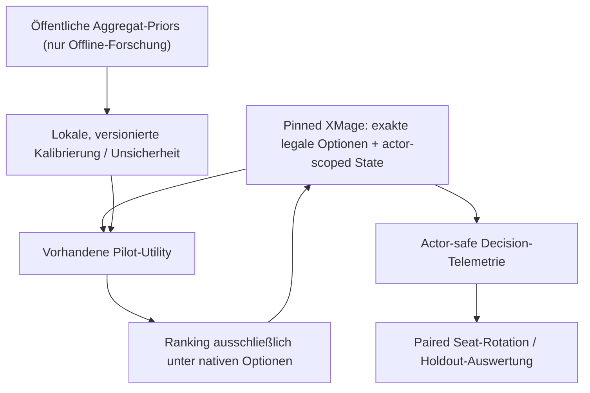

# Playgroup Live — Phase 5: KI, Sparring und Pilot-Kalibrierung

**Datum:** 2026-11-08 · **Lab-Quellstand:** `main@79b549ba576d5cc612b4ab92cd17b28ebe25d0e6` · **Untersuchung:** Playgroups öffentliches Sparring-Modell, Interaktionsverteilungen, Boardwipe-Risiko, Removal-Zielwahl, bestehende native XMage-Piloten und die Chulane-Strategie. **Keine Pilot-Implementierung geändert; keine neuen Spiele ausgeführt.**

**Bindende Regeln:** Chulane ist das einzige aktive persönliche Deckbauziel (separater PR #1134, ungemergt zum Zeitpunkt dieser Recherche). Commander-Tests: **4 Spieler Standard, maximal 6**; acht ausschließlich statische/nativ-isolierte Forschung außerhalb des produktiven Simulators. XMage und nur XMage entscheidet Regeln, legale Optionen, Kosten, Priorität, Sichtbarkeit und Spielausgang. Keine personenbezogenen Sammlungsdateien `data/collections/**` gelesen; keine persönliche Liste an Playgroup übertragen.

## 1. Zusammenfassung und strikte Evidenztrennung

**Befund:** Playgroup Sparring ist *kein* vollwertiger MTG-Gegner, sondern ein statistisch ausgelöster „Phantom“-Reaktionsgenerator für Goldfishing. Die Playgroup-Dokumentation erklärt explizit: **keine vollständige Regel-Engine, kein autonomes KI-Deck**, ein manueller Antwortentscheid auf Ehrenbasis. Das Produkt nutzt Verteilungstabellen, grobes Timing und Threat-Rates.

**Unser Lab ist ein anderes System:** reale 100-Karten-Decks der Gegner, echte XMage-Handkarten und Manaressourcen, native `legal_options`, autonome Strategiewahl. Playgroup könnte nur **empirische Spielverhaltens-Priors und Evaluationsziele** liefern. Reaktionen ohne tatsächlich vorhandene/legale XMage-Karte wären eine unzulässige zweite Regel-Engine.

Die dokumentierten Prozentwerte sind **Kategorienanteile unter schon tatsächlich gespielten Interaktionszaubern**, nicht `P(Counter | gegnerischer Cast)`, `P(Removal | Landung einer Kreatur)` oder `P(Wipe im nächsten Zug)`. Ohne die Nenner „verfügbare Gelegenheiten“ und „legal verfügbare Antworten“ kann keine kausale oder korrekt normalisierte Entscheidungshäufigkeit berechnet werden.

Evidenz-Typen in diesem Dokument:
- `VENDOR_DOCUMENTED`: Aussage von Playgroup über eigene Statistik / Produkt, keine unabhängige Rohdatenverifikation.
- `CODE_DERIVED`: konkretes Verhalten des inspizierten Lab-Codes, noch kein neuer HEAD-Vollspieltest.
- `HISTORICAL_OBSERVED`: bereits dokumentierte historische Lab-Resultate, nur für ihr exaktes Setup.
- `PROPOSED`: Architektur, Metrik, Test oder Priorität, **nicht implementiert und nicht bestanden**.

## 2. Exakte öffentlich veröffentlichte Sparring-Daten

Quelle [Playgroup: How Sparring Works](https://playgroup.gg/playgroup-live/how-sparring-works), Anbieterstand laut aktueller Seite **2026-11-06**; historische Cache-Versionen der Seite können älter sein.

| Wert | Vom Anbieter berichtete Beobachtung | Korrekte Interpretation |
|---|---:|---|
| Vollendete Spiele | **6.934** | Datensatz zum Archetypenmix, keine Stichprobe unseres XMage-Pools |
| Interaktionszauber insgesamt | **21.480** | Beobachtete **Casts** nach Filter, nicht „Gelegenheiten“ |
| Spot Removal | **58 %** | Anteil unter erfassten Interaktionszaubern |
| Counter | **19 %** | Anteil unter erfassten Interaktionszaubern |
| Boardwipe | **13 %** | Anteil unter erfassten Interaktionszaubern |
| Bounce | **7 %** | Anteil unter erfassten Interaktionszaubern |
| Edict | **3 %** | Anteil unter erfassten Interaktionszaubern |
| Wraths bei 0–1 Kreaturen | **1,0× Referenz** | Relativgewicht, **keine absolute Wahrscheinlichkeit** |
| Wraths bei 2 Kreaturen | **1,3×** | Keine separaten Netto-/Opportunity-Zähler veröffentlicht |
| Wraths bei 3+ Kreaturen | **2,5×** | Relativassoziation; `606` Wipe-Casts; effektiver ab ca. Runde 5 |
| Nichtland-Permanents gelangten ins Spiel | **1.181.742** über 120 Tage | Expositionspool für Kartentargeting-Messung |
| Entfernung innerhalb 60s nach gegnerischem targeted Removal | **36.034**, ungefähr **3 %** | Zeitfenster-Heuristik, enthält Zufall/Battlefield-Verlassen durch andere Effekte |
| Mindestzahl Landungen pro eigener Karten-Rate | **400** | Anbieter-Schwelle; 460 Karten qualifizieren |
| Nicht mehr gezielte selten entfernte Karten | **82** mit `<1 %` | Häufig Mana- und Ramp-Permanents; kein „niemals entfernen“-Regeltext |
| Antwortkarten in Phantom-Pool | **etwa 120** | Manuell kuratierte Kartentyp-Antworten, **keine vollständige Legalitätsprüfung** |
| Druckstufen | Light / Realistic / Cutthroat | Skaliert die Reaktionshäufigkeit; konkrete Skalierungsfaktoren nicht belegt |

**Weitere Herstellergrenzen:**
1. Rundenspezifische Kurven für Removal/Counter/Wipe werden grafisch gezeigt, aber die **exakten 12+-Bin-Zahlen sind nicht in der öffentlich abrufbaren Textbeschreibung ausgewiesen**. Keine scheinpräzisen Werte abschreiben oder interpolieren.
2. Tokens waren in der referenzierten Offline-Boardwipe-Analyse **nicht mitgezählt**. Das ist besonders relevant für Chulanes Clue-/Token-Strategie, auch wenn Clues als Artefakttoken selbst keine Kreaturen sind.
3. Der 60-Sekunden-Removalindikator misclassifiziert gelegentlich Kampf, temporäre Effekte und andere Ereignisse. Er ist **keine** verlässliche kausale Ziel-Priorität und keine Engine-Regel.
4. Playgroup ist vor allem **casual/mid-power**, keine repräsentative cEDH- oder universelle Commander-Population ([Datenmethodik](https://playgroup.gg/about)). Korrektheit/Unabhängigkeit ihrer Rohzählungen nicht extern geprüft.
5. Die öffentliche aggregierte Statistik wird vom Betreiber als **CC BY 4.0** lizenziert ([Legal](https://playgroup.gg/legal)); ausreichende Attribution und Lizenzhinweis erforderlich. Kartenbilder und Playgroup-Implementierungscode sind davon **nicht** erfasst.
6. Keine öffentlich dokumentierte API liefert direkt die vollständigen Roh-Interaktionsfenster, Karten in Händen und alternativen legalen Antworten; keine solche Exportfähigkeit behaupten.

## 3. Gegenüberstellung zur tatsächlich vorhandenen Lab-Pilotlogik

| Thema | Playgroup Sparring | Bereits vorhanden im XMage-Lab | Konkrete Lücke / sinnvolle Verbesserung |
|---|---|---|---|
| Volle Gegnerdecks | Phantom ohne eigene real ausgespielte Hand/Deck | Echtes Deck + Karte/Fakten + native XMage-Angebote | **Keinen Phantompfad hinzufügen** |
| Reaktionsmix | 58/19/13/7/3 unter Casts | Rollen/Funktionen `REMOVAL`, `COUNTER`, `WIPE`, legitime Entscheidung | Häufigkeitsprofile **nur als Mess-/Vergleichsziele**, nach Opportunitätsnormalisierung |
| Timing | Rundenkurven; frühe Züge ruhig | `_instant_timing`, Mana-Hold, Pass-/Priority-Score | „Antwort jetzt oder auf spätere Gelegenheit warten?“ mit echten späteren Opportunitäten bewerten |
| Counterspell | Phantom gegen typisierten Cast | `counter_target_worth`, Stack, eigene/andere Spells, Mana-Hold | Bedrohung des einzelnen Stack-Objekts, Gegner-Siegfenster, Interaktionstempo, Redundanz |
| Spot Removal | Gemessene generelle Karten-Removal-Rates | `best_removal_target_value`, `_card_threat`, `player_threat`, `_target_alignment` | Mehrdimensionaler Zielwert: Engine, unmittelbar tödliche Uhr, Wiederholungs-ETBs, Schutz/Ressource |
| Boardwipe | Relativgewicht nach Kreaturenzahl / Runde | `boardwipe_risk` aus eigenem Boardwert vs. Gegnerdurchschnitt × Handkarten | Kalibrieren als **Beobachtungsrisiko**, nicht anhand des 2,5×-Werts als absolute Cast-Wahrscheinlichkeit |
| Bedrohung / Politics | Einfache remove-by-rate-Zielliste | `_target_action`: ungefähr **70 % Kartenbedrohung + 30 % Spielerbedrohung**; `archenemy`-Schwelle | Threat Clock, notwendige Interaktion, Stack/Board-Synergien, Mehrgegnerkosten und politischer Preis |
| Schutz / Resource Reserve | Nutzer beantwortet Phantom „hast du eine Antwort?“ selbst | Tatsächliche legale Schutz-/Counter-Antwort im Spiel | Schutz nicht überfrüh auslösen, Commander-Wert vs. Boardwipe, echte Reaktion statt Fizzel |
| Schwierigkeit | Light / Realistic / Cutthroat Reaktionsraten | Vier `PilotStrength`-Stufen mit verschiedenen Temperatur-/Fehler-/Ressourcenparametern | Stufen sind **nicht automatisch vergleichbar**; separate Challenge-Profile nur nach Kalibrierung |
| Statistische Verbesserung | Publizierte Aggregate | `pilot_decision_report.py`, `threat_report.py`, `rank_sensitivity.py` | Per-Opportunity Exposition, Erklärbarkeit, Unsicherheitsintervalle, sorgfältige Paired Trials |

**Inspektierte Lab-Quellen (CODE_DERIVED):**
- `src/commander_lab/engine/rules/full_game_pilot_views.py` enthält `archenemy`, `boardwipe_risk`, `counter_target_worth`, `priority_view_fields`, `_instant_timing`, `best_removal_target_value`.
- `src/commander_lab/engine/rules/full_game_pilot/state.py`: `_pilot_state` projiziert reale Gegner, Board, Life, Hand-**Anzahl** und Bedrohung; `_target_action` gewichtet Karten-/Spielerbedrohung **0.7/0.3**. `hidden_information_uncertainty` ist in dieser Ansicht aktuell **1.0**, kein empirisch trainiertes Posteriormodell.
- `src/commander_lab/engine/rules/full_game_pilot_mana_hold.py`: hält günstige Counter-/Removal-Instants (max Mana Value **3**) zurück, mit begrenzter Wartezeit von **2** eigenen Zügen, statt endlos Mana offen zu lassen.
- `src/commander_lab/engine/rules/full_game_pilot/priority.py`: Priority-Entscheidungen aus legalen Optionen, Pass und gezielte `withhold`-Strategien; keine eigene Regelfreigabe.
- `src/commander_lab/agents/pilots.py`: Stärken und Utility-Gewichte; `NEAR_OPTIMAL_HEURISTIC` ist eine Heuristik-Klasse, kein Nachweis spieltheoretischer Optimalität.
- `scripts/pilot_decision_report.py`: per-seat Spells, Idle-Main, Removal auf eigene Permanents, Wipes bei eigenem Boardvorsprung, Counter auf eigene Spells, `castable_but_uncast` u.a.; gewählte Cast-Aktionen sind nicht gleich erfolgreich resolved Spells.
- `scripts/threat_report.py`: (P(\mathrm{loss}\mid\mathrm{opp\ card\ played})/P(\mathrm{loss})), aktuell minimum appearances **5**; ausdrücklich korrelativ, massiv vom gegnerischen Deck/Pod konfundiert.
- `docs/performance/PILOT_NEXT_RANKING_2026-10-30.md`: historische 24-Pod-Untersuchung: Counter/Removal-Mana-Hold ist bereits integriert (#1031); damals **+10 %** solche Casts, **Winrate UNDECIDED**. Nicht als sichere Stärkeänderung verkaufen.
- `docs/performance/PILOT_RANK_SENSITIVITY_PROTOCOL.md`: vorhandener `scripts/rank_sensitivity.py`-Ansatz mit mindestens **40 Seeds**/Pod, vier Seat-Rotationen, blockgebundener Auswertung und Ranking-Stabilitätskontrolle.
- `data/deck_guides/guides/chulane.json`: Chulane-Rollen `counter=4`, `removal=6`, `protection=7`, `wipe=2`, `engine=22`, `token_source=13`, `recursion=0` **als CODE_DERIVED/MODELED Kartensicht**, keine beobachtete Pilothäufigkeit.

## 4. Nicht zulässige Kurzschlüsse

1. **58 % Removal `!=` 58 % Chance pro Prioritätsfenster.** Verteilung `P(Typ | Interaktions-Cast)` verrät `P(Cast | Typ legal angeboten, Bedrohung)` nicht.
2. **2,5× Boardwipe `!=` 2,5× des bestehenden Piloten-Scores ohne Validierung.** Unterschiedliche Baselines, Tokenexklusion, Endogenität: breite Boards erfordern auch Ressourcen und Gegnerzüge.
3. **`3 %` removed within 60s `!=` Chulane wird mit 3 % Wahrscheinlichkeit entfernt.** Andere Karten, Faktoren, Sichtbarkeit, Standard-Mana und Timing; Beobachtungsbias.
4. **Ein eigener stärkerer Pilot `!=` automatisch realistischere Gegenspieler.** Ein starker Pilot kann zu viel oder zu wenig interagieren. Stärke und menschliche Verhaltenstreue sind **separate** Achsen.
5. **Ein passender Kartenname `!=` echte Antwort.** Nur reale Hand-/Mana-/Priority-Optionen des gepinnten XMage zählen.
6. **Keine Opponent-Hand-Inferenz aus Oracle-/Deckwissen als Tatsachenbehauptung.** Ein Prior über Möglichkeiten darf niemandem private Karteninformationen geben; actor-scoped Sichtrechte gelten uneingeschränkt.
7. **Ein Kartendaten-Feature `!=` Regeln.** Externe Daten dürfen nur den relativen Strategiewert **bereits angebotener** Aktionen beeinflussen; nie Legalität, Target-Set, RNG, Spielende, Zone oder Stack rekonstruieren.

## 5. Architektur: sichere, optionale Kalibrierung



**Nicht als Produktfunktion umgesetzt.** Eine mögliche, *erst nach Validierung* freischaltbare Strategie-Ergänzung:

```text
A = authoritative_XMage_legal_options(current_decision)
base = existing_utility(action, actor_scoped_state)
context = public_board + actor_own_hand + real_time_window
candidate_score(action) = base + lambda * calibrated_contextual_behavior_prior(action, context)
choice = argmax_over_A(candidate_score)
```

`lambda` ist **unbestimmt**, nicht heimlich 0.19 oder 2.5. Ohne empirischen Nutzen ist `lambda=0` (= heutige Policy). Keine Prozentwerte direkt als rohe Utility addieren; bedingte Wahrscheinlichkeiten, Expositionsnenner, Regularisierung und Unsicherheit müssen erst modelliert werden. Falls `A` nicht projezierbar oder Berechtigung unklar ist: **fail closed**, nicht „einfach Pass“ oder Phantom-Action.

### Messschema / Observability (PROPOSED)

Je **echtem** Entscheidungsfenster der operativen XMage-Bridge, ausschließlich actor-safe:

| Feld | Funktion |
|---|---|
| `source_lock`, `engine_pin`, `pilot_version`, `policy_version`, `seed`, `pod_id` | reproduzierbarer Messblock |
| `seat`, `pod_size`, `turn`, `phase`, `step`, `decision_class` | Zeitpunkt / Vergleichsstrata |
| `legal_action_kinds_offered`, `chosen_action_kind`, `pass_offered` | Nenner / Zähler für **Gelegenheit vs. tatsächliche Entscheidung** |
| `cast_options_with_interaction_role`, `real_answer_available` | separates Risiko vom bloßen beobachteten Cast unterscheiden, actor-scoped |
| `public_creature_count_by_seat`, `public_tokens_by_kind`, `stack_public_roles`, `life_by_seat` | öffentliche Druck-/Bedrohungsfaktoren |
| `own_interaction_role_count`, `own_mana_access` | nur für eigenen Piloten, nie in fremder Beobachtung |
| `decision_score_components`, `withhold_reason`, `calibration_model_version` | auditierbare Begründung |
| `action_accepted`, `cast_reached_stack`, `mana_cancelled`, `spell_resolved` | Entscheidungs- vs. Erfolgsmetrik sauber trennen |
| `event_digest`, `actor_scoped_redaction_check` | Replay-/Privacy-Kontrolle |

**Datenrestriktion:** Keine gesamte gegnerische verdeckte Hand in Aggregatreports; keine fremden Decklisten/Collection-IDs exportieren. Für Gegenüberstellung mit Playgroup nur veröffentlichbare **Klassenaggregate**, nie private Einzelsequenzen. `source_lock`/Versionen statt persönlicher Nutzernamen.

### Kalibrierungsstrategie

A. In-game-Opportunity-Rate zuerst lokal messen: z. B. Counter **ausspielbar** in Prioritätsfenstern mit relevantem fremden Zauber auf Stack; Removal **legal und zielführend** für ein öffentliches gegnerisches Objekt; Wipe **ausspielbar** und wirklich mit mehreren relevanten gegnerischen Creatures. Alle Fenster je Spiel/Seat kumulieren, aber Unsicherheiten auf Spiel-/Seed-Blöcken berechnen, nicht über korrelierte einzelne Priority-Pings.

B. Playgroup-Anteile nur als **schwache externe Zielverteilung** für beobachtete **Casts bei vergleichbarem Pool**, nicht als Transition-Hazard. Fehlende Opportunity-Nenner und Auswahl-/Deck-Populationsbias ausdrücklich dokumentieren. Alternativ solche Priors zunächst ausschließlich im Dashboard anzeigen.

C. Regularisierung / CIs: Artenraten mit kleinem `n` zu einer breiten Baseline schrumpfen; nicht Karten mit 400 Landungen automatisch als statistisch ausreichend für jede Chulane-Situation einstufen. Berichte rohe Zähler, Nenner, Unsicherheitsintervall, Profil und Zeitpunkt.

D. Counter/Removal nach **Wert des bedrohten Effekts**, zugänglichem Mana und Folgezuständen konditionieren; Wipes nach Opferkosten des **eigenen** Boards, überlebenden Gegnern, Schutz und echten K.O.-Clocks. Beim Chulane-Piloten Schutz und Eigenwert unterschiedlich behandeln als bei den Gegnern.

E. Keine „Light/Realistic/Cutthroat“-Abbildung aus den reinen Verteilungen: Die Anbieter-Skalare sind nicht veröffentlicht. Unsere Pilotstärke darf nicht nur über die Gesamtzahl künstlich erzeugter Antwortzauber angepasst werden. Getrennte Kontrollregler für `human_likeness` (kalibrierte Wahl unter realen Optionen) und `strength` (bestmöglicher eigener Nutzen).

## 6. Chulane-spezifische Bedrohungs- und Gegenreaktionslogik

### Eigener Chulane-Pilot

- **Commander im Fokus:** Chulane ist Value-/Land-Engine, nicht die primäre Voltron-Kill-Clock. Eine irreversible Entfernung / Tax kann die eigene Entwicklung verzögern; trotzdem Ressourcen nicht automatisch für jeden Angriff auf Chulane verschwenden, wenn ein Gegner unmittelbar gewinnen kann.
- **Reale Gegenwehr:** Folgt eine gegnerische Removal-/Wipe-Aktion, Chulane nur durch tatsächlich erlaubte Counter-/Schutzoptionen retten. `Whitemane Lion` kann zu Bounce-Reaktionen beitragen, aber keine erfundene Flash- oder Cast-Berechtigung.
- **Überentwicklung:** Kleine Kreaturen + Bounce + Landfall ergeben starkes Boardwachstum; Boardwipe-Exposition erhöhen. Für Wipe-Risiko öffentliche **Kreaturen** (inklusive Kreaturtoken) und eigene relative Engine-Value messen. **Clue-Artefakttoken zählen nicht als Kreaturen**; ihre Rolle beim Boardwipe hängt vom tatsächlichen Effekt ab.
- **Stack-Entscheidungen:** Ein Counter sollte auf gegnerische schnelle Winlines / starke Removal auf die Chulane-Engine gehen, nicht bloß auf einen teuren, harmlosen Spell.
- **Sequenzierung:** Guide erwartet Creature-Spells im eigenen Hauptzug für Chulane-Draw+Land, Interaktion mit mana hold und `Wilderness Reclamation`-Fenstern. Gegen Wipe-Druck nur so viele extra Creatures entwickeln wie strategisch sinnvoll, ohne die Regelzeitpunkte zu fälschen.
- **Plan B:** `Lonis`/`Academy Manufactor`/Clues, `Mechanized Production`, Landfall und `Psychosis Crawler` als echte Schutz-/Win-Uhren erkennen; Chulane-Ausfall ≠ automatisch null Win-Chance.

### Gegner gegen Chulane

- Priorisieren nicht mechanisch immer den Chulane-Commander; prüfen **Engine-Payoff**, unmittelbaren Sieg, verfügbare Antwortfarbe/-kosten, Threats der anderen Gegner, danach öffentlich sichtbare Chulane-Bounce-/Clue-Synergien.
- Wipe-Aktivierung nur bei **tatsächlich verfügbarer** XMage-Aktion, nicht automatisch bei 3 Kreaturen; den eigenen Boardverlust und den Gewinn der anderen drei bis fünf Spieler berücksichtigen.
- Gegner, die keine Counter/Removal im Deck oder Hand haben, dürfen solche Antworten **nicht** produzieren, unabhängig vom 19%/58%-Benchmark.
- Für echten 4P/6P-Einsatz mögliche Hot-Seat- und Koalitionsdynamiken als strategische Bewertung erfassen; keine magischen Side-Deals / hidden hand inference.

## 7. Priorisierter Umsetzungsplan und harte Gates

| Stufe | Deliverable | Abnahme |
|---|---|---|
| **P0-A** | Baseline-Entscheidungsreport `pilot_decision_report.py`; `threat_report.py`; für Chulane und öffentlich erlaubte Gegner. Keine Änderung an Piloten. | Quelle/Pod/Seed/Seats bekannt, echte `status=ok`-Partien und Fehler vollständig, `UNKNOWN` sauber markiert |
| **P0-B** | Feature-/Opportunity-Census mit getrennten Zählern für angeboten, gewählt, bezahlt, auf Stack, resolved | Verwechslungs-/Leakage-Negativtests, per-seat/turn ohne doppelte Priority-Fenster als unabhängige Samples |
| **P0-C** | Chulane-Pilot und Gegner: 12+ Gold-Decision-Cases mit gefährlichen Wipes, Counter, bedrohten Engine-/Artifact/Clue-Payoffs, eigenen Selbstschäden | Expert-approved zulässige Auswahlmengen, native offer-only; kein erfundener Target |
| **P1-A** | Offline-Kalibrierung eines **optional deaktivierten** Threat-/Timing-Priors, erst mit eigenen Kalibrierungsdaten | Keine Richtwertübernahme als absolute Wahrscheinlichkeit; externe Quelle CC BY 4.0 + Unsicherheit |
| **P1-B** | A/B-Pilotstrategie mit **gleichen Seeds, gleichen Pods, 4 Sitz-Rotationen**, separaten Entwicklung-/Holdout-Sets | No-replay-divergence, aktuelle Qualifikation der Engine, nicht höhere Failure-Rate / Ressourcenexplosion; gegnerische Stärke und Realismus separat |
| **P1-C** | Chulane-spezifische Resilienz & Gegenreaktionen in 4P, anschließend maximal 6P | Dokumentierte Wipe-/Removal-Reaktion, echte erlaubte Antworten; kein generierter Phantom-Antwortzauber |
| **P2** | Optionales `realistic_interaction` Profil neben `strong`, `balanced`, `experimental` nur bei belegter Differenz | Feature-Flag OFF standardmäßig; keine scheinpräzisen Mix-Ziele oder Gewinnversprechen |

**Statistische Anforderungen:**
- Vorab definierte Metriken/Hypothesen; zwei Pod-Typen (Precon/mixed oder optimized) und getrennte Begegnungen **Chulane als Pilot** / **Chulane als Bedrohung für Gegner**.
- Für die sensitive **Deckranking**-Fragestellung den vorhandenen `scripts/rank_sensitivity.py`-Vertrag wiederverwenden: mindestens **40 Seed-Blöcke pro Pod** und alle **4 Sitzrotationen**, soweit Infrastruktur und Budget erlauben. Bei geringerem Budget nur `PILOT / EXPLORATORY`, keine Signifikanzbehauptung.
- Cluster-Bootstrap/paired permutation auf kompletten Seed-/Pod-Blöcken; nicht die tausenden zugehörigen Decision-Frames als unabhängige Spiele behandeln.
- Primär: regelkorrekte vollständige Spiele, kein Fail Closed Fehler, keine privaten Leaks, stabiler Winshare/Rangvergleich; sekundär: Counter auf eigenes Stack-Objekt, Removal-Fehlziel, Wipe-vs-own-board, Action-Timeouts, ausspielbare aber ungespielte Interaktion, verfügbar gehaltenes Mana und echte resolved Casts.
- Stop/Rollback bei mehr Engine-Aborts, unverifizierten Entscheidungen, Informationslecks, gezielt induzierten Loops, erheblichen Rechen-/RAM-Mehrkosten oder Chulane-Pilot-Fehlern.
- **Weder Phase 5 noch die vorliegenden Quelldaten haben diese Tests ausgeführt.**

## 8. Konkrete Nicht-Übernahme von Playgroup

- Kein „Phantom-Counter“, Phantom-Removal oder „Wipe jetzt wegen Multiplikator 2,5“, auch nicht nur für Solo-Modus, solange diese Aktion keinen legalen realen XMage-Quelleffekt besitzt.
- Kein „Karte wird 60 Sekunden nach irgendeinem gegnerischen Cast entfernt“ als Reglauflösung.
- Keine Übernahme von Playgroups proprietärem Modellcode, privatem Antwortpool oder nicht veröffentlichten Rundengewichten; öffentlich dokumentierte **Aggregatwerte** sind kein vollständiges Modell.
- Kein kopiertes oder fremd-lizenziertes Kartenartwork. Statistik nach CC BY 4.0 nur mit Quellen-Attribution.
- Kein zusätzlicher Rules Resolver im Piloten, kein Echtgeld-/Nutzerdeck-Upload, keine Sammlung in diesem Workstream.

## 9. Empirische Testfälle und Quellen

Konkrete vorgeschlagene Entscheidungstests: [Chulane pilot interaction matrix](PLAYGROUP_LIVE_PHASE5_CHULANE_INTERACTION_CASEBOOK_20261108.md).

### Externe Primärquellen

- [Playgroup Sparring – Messdaten, Formeln und Grenzen](https://playgroup.gg/playgroup-live/how-sparring-works), Anbieterstand 6. Nov. 2026.
- [Playgroup Data Methodology](https://playgroup.gg/about), Aggregation, Casual-/Mid-Power-Bias und periodische Aktualisierung.
- [Playgroup Live](https://playgroup.gg/playgroup-live), Light/Realistic/Cutthroat und Abgrenzung von KI.
- [Legal](https://playgroup.gg/legal), anonymisierte aggregierte Statistiken CC BY 4.0.
- [Playgroup Cards](https://playgroup.gg/cards), beobachtete card-level Playgroup-Live-Spieldaten.
- [Chulane-Commander-Stats](https://playgroup.gg/commanders/2143-chulane-teller-of-tales), nur explorativ: besonders 5/6P-Teilgruppen sind klein, andere Pods/Seats/Decks konfundiert.
- [Playgroup Comparison](https://playgroup.gg/playgroup-live/play-commander-online), explizit manuelle Regelhilfen vs. XMage.

### Lab-Reproduzierbarkeit

- `config/rules_engines.json` ist die einzige verbindliche XMage-Pinquelle.
- `src/commander_lab/engine/rules/full_game_pilot_views.py`, `full_game_pilot/state.py`, `full_game_pilot/priority.py`, `full_game_pilot_mana_hold.py`, `agents/pilots.py`.
- `scripts/pilot_decision_report.py`, `scripts/threat_report.py`, `scripts/rank_sensitivity.py`.
- `docs/performance/PILOT_NEXT_RANKING_2026-10-30.md`, `docs/performance/PILOT_RANK_SENSITIVITY_PROTOCOL.md`, `data/deck_guides/guides/chulane.json`.

**Phase-5-Status:** `PUBLIC_SPARRING_RESEARCH=COMPLETE`; `LAB_PILOT_CODE_AUDIT=COMPLETE`; `PRIORITIZED_SAFE_IMPROVEMENT_PLAN=COMPLETE`; `NEW_PILOT_IMPL=NOT_STARTED`; `NEW_XMAGE_GAME_TESTS=NOT_RUN`; `PLAYGROUP_RAW_OPPORTUNITY_DATA=NOT_AVAILABLE`.
