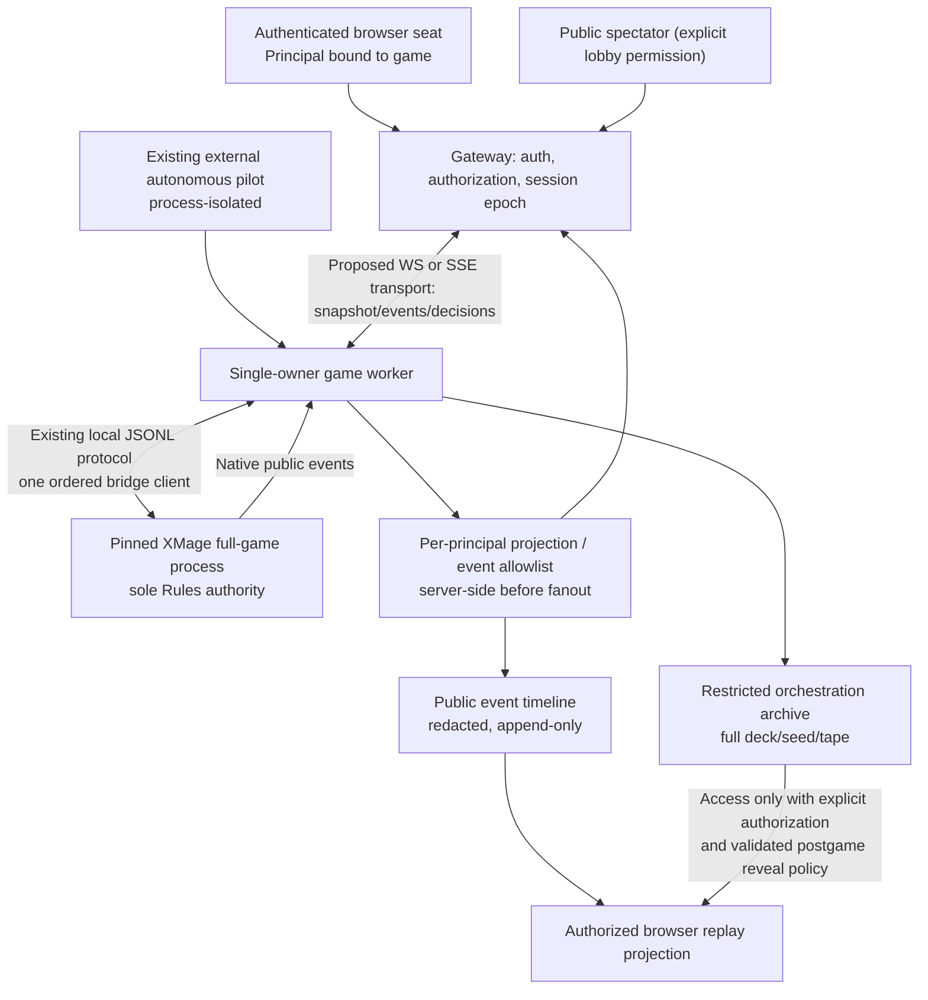
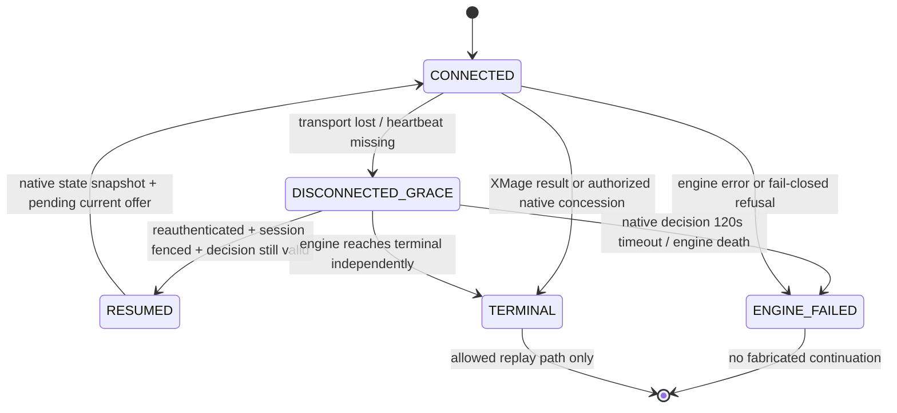

# Playgroup Live — Phase 6: Multiplayer, synchronisation and replay architecture

**Date:** 2026-11-08 · **Lab source lock:** `main@79b549ba576d5cc612b4ab92cd17b28ebe25d0e6` · **Scope:** documented Playgroup Live behaviour and the actual XMage JSONL bridge / event / replay / privacy contracts. **Deliverable:** target integration architecture, gateway/transport contract proposal, security model, reconnect state machine, replay separation, test gates, implementation work breakdown. **No network server, client, replay contract or bridge behaviour is implemented by this research PR.**

**Binding Owner scope:** Chulane is the only current personal deckbuilding focus (draft PR #1134); **four-player default, six-player maximum**, never admit more than six into new production simulation sessions (Owner decision in draft PR #1135). Eight seats may be studied only in isolated research, not this product. **Only pinned XMage adjudicates MTG rules**; neither frontend nor gateway performs a legal action on its own. No `data/collections/**` accessed; no private owner deck data sent to Playgroup.

## 1. Executive integration verdict

- **Playgroup is an excellent network UX reference**, but it does **not** provide a public source-level protocol we can safely copy. Its documented spectator, reconnect, handoff and undo flows are product features, not proof that they use WebSockets/Redis/pubsub for game events internally.
- **Our Lab already has native authoritative state projections, an engine-derived public event tape and two distinct replay lanes**. It does **not** yet have an authenticated multi-user browser transport, per-seat persistent session service, live spectator entitlements, rejoin handoff, or an established safe human decision gateway.
- **Build an orchestration gateway around the existing pinned XMage bridge**, not a parallel rules system. Prefer a single ordered per-game worker connected to the existing JSONL protocol; WebSocket or SSE is a *proposed browser transport*, not an existing Lab endpoint.
- **Do not connect the web directly to raw `get_full_game_decision` or `export_replay` responses.** Those contain actor-private information or entire decklists/seed/decision history. The gateway must enforce authentication, role-scoped projection and typed field allowlists *before* serialization, buffering, storage, or fanout.
- **Do not promise transparent reconnection across a failed engine decision:** native decision timeout is currently **120 seconds and fails closed**. Rejoin can recover a still-live pending decision if it is reauthorized and within deadline. Once the engine has failed/terminated, the UI must show failure; restart or qualified replay is a separate audited flow, never an invented continuation.

## 2. Playgroup Live: verified features versus unknown internal implementation

| Area | Playgroup vendor documentation says | What is **not** independently established |
|---|---|---|
| Sessions | Private/public 2–6 seat lobbies; scheduled and immediate starts | Exact lobby database schema, auth/host tokens, route-level policies |
| Realtime | Server-authoritative table state; live card-drag previews, active player HUD, hidden hands | Server sync transport (WebSocket/SSE/poll), event ordering, ack protocol, snapshot version |
| Hidden info | Server hides face-down/hand/library identities, selective reveal to one player | Exact field schema, security review of every frame |
| Spectators | Anyone may watch a **public** live game without account; board + event log in real time | Private game observer auth contract, per-frame permission changes |
| Voice | Public-game spectators can listen; registered viewers may ask host to speak | Whether audio callbacks and game-state traffic share infrastructure |
| Chat | In-game text chat supported | Exact message API; official privacy page explicitly says **spectators cannot see/send chat** |
| Reconnect | Reconnect, host handoff and disconnect handling improved (2026-07-10) | State snapshots, replay-on-rejoin algorithm, timeouts, backend failure guarantees |
| Missing player | If active player disconnects, another person can skip a turn after grace | This is a **manual-table UX policy**, not acceptable as an automatic Rules step in our engine |
| Undo | Last-action undo and unrestricted solo-goldfish undo | No public guarantee of rules-equivalent rollback/deterministic seeded replay |
| Replay | Finished game can be replayed move-by-move and **fully reveals hidden hands**; full reveal requires a Supporter Pack at the table | ACL implementation, player consent for previously hidden information, raw export shape |
| Audio/video | Self-hosted LiveKit, no stored audio/video, no video in replay | Internal LiveKit/Redis transport topology and credentials |
| Text retention | Redis temporary, 24h after completed game / 48h after unfinished game (current privacy statement) | Actual TTL enforcement evidence outside vendor declaration |

**Official sources:** [Playgroup Live](https://playgroup.gg/playgroup-live), [Features](https://playgroup.gg/playgroup-live/features), [July 10 developer update](https://playgroup.gg/posts/99-playgroup-live-two-months-of-updates), [Privacy](https://playgroup.gg/privacy), [Support / replay entitlements](https://playgroup.gg/support). **Evidence:** `VENDOR_DOCUMENTED` only; no authenticated live browser session, websocket frame capture, or original private source inspection occurred.

**Interpretation:** Playgroup's full-reveal postgame policy is not automatically suitable for our local Chulane decks. In our product, private/replay entitlements must be independently chosen and cannot be inferred from game completion or a public-lobby flag.

## 3. Current Lab implementation inventory (code-derived, not live-browser qualification)

| Source and contract | Already exists | Exact limit / integration concern |
|---|---|---|
| `engine-bridge/.../XmageFullGameJsonlBridge.java` | JSONL `create_full_game`, `start_full_game`, `get_full_game_decision`, `submit_full_game_decision`, `get_full_game_result`, `export_event_log`/`get_event_log`, `export_replay`, `shutdown_game` | Orchestration-only process protocol, **not** browser-authenticated live-session API |
| `XmageFullGameDecisionController.java` | One blocking authoritative decision, `decision_id`/`decision_offset`, deciding actor, typed `legal_options`, choice-validation, timeout | **120s decision timeout**, wrong actor / stale decision / off-menu option rejected; no automatic UI-pause/rejoin |
| `XmageFullGameStateRedactor.java` | `actorView` and `publicView`, hidden-zone cards, granted looks, face-down protections, controller-of-another-player semantics (CR 723) | Viewer role checks still need a **new** authenticated browser boundary; the redactor's actor-view is **not** a public broadcast |
| `XmagePublicEventWatcher.java` | Native engine public events: zone changes, spells, damage, counters, triggers, etc.; hidden cards protected by stateful exile settling | Bounded event subset, not every raw XMage event; audit `data`, source names, temporal exposure for browser role changes before product release |
| `XmageFullGameSession.eventLogPayload` | `after_offset`, `latest_offset`, `decision_count`, `observation_scope=public`, array of public event rows; monotonic event sequence | An event cursor is a **read offset**, not a reconnectable snapshot/replay contract on its own |
| `XmageFullGameSession.replayExportPayload` | Orchestration replay with Rules seed, **decklists**, all semantic decisions, game digest, final pending | `scope=orchestration_only` and **private**; not for spectators, no built-in browser playback permission |
| `XmageFullGameReplayVerifier.java` | Fresh-process native replay verifier checks exact decision class, seat and offered-option digests | Independent replay evidence, not live spectator playback |
| `src/commander_lab/semantic_replay/{tape,recorder,consumer}.py` | Source-locked semantic tape record + replay with principal hashes and divergence checks | `TapeGameManifest.player_count` 2–5, `TapeSeatPrincipal.seat` 1–5, `TapeReplayStep.actor_principal` 1–5: **6P unqualified in that lane** |
| `src/commander_lab/engine/rules/full_game.py` | Python process client, engine-driven pilot decisions, actor-scope audit per frame, graceful/failure shutdown | Current pilot executor drives automatic full games, not waiting for humans in persistent browser |
| `src/commander_lab/api/tool_server.py` | FastAPI health, tool/workflow and structural-demo endpoints | **No** authenticated WebSocket/live-play fanout or browser-native session lifecycle currently |
| `docs/PROJECT_MISSION.md`, `AGENTS.md` | Single XMage Rules authority, isolation, recorded evidence/source lock, no fallback | New architecture must preserve all; do not edit policy files in this PR |

**Important nuance about “Replay works at six”:** Full-game **bridge export** and its verifier are a different capability from the **WS218 semantic tape** and from user-visible **browser playback**. One cannot claim that the latter two are six-player-qualified because a six-player game completed or a bridge export command exists.

**Important nuance about “Event log is safe”:** `publicEvent` currently allows certain native public fields including `data`, `source_name`, `target_name`. Although the watcher has privacy filters, a future *network* surface must be independently checked on hidden-to-exile/face-down/controlled-turn transitions before spectator PASS. This is a **required audit**, not an assertion of an existing leak.

## 4. Proposed integration architecture (not implemented)



### Runtime/process ownership

- **Exactly one controlling gateway worker per running game** owns the bridge process and sends ordered JSONL requests. Arbitrary browsers never access the process stream, the raw principal UUIDs or the replay exporter.
- **One active command lease per seat/principal/session epoch**; multiple viewing tabs may exist, but only one writer. Transport reconnect increments epoch/fencing token; queued actions from earlier epochs are rejected.
- The gateway cannot invoke a Rules Core alternative. A human and an autonomous pilot submit a choice through the **same** engine-native decision contract; they differ only in identity, session and choice policy.
- Distinguish: `game_id` (not secret), `seat_id`/public token, `principal_auth` (private), `decision_id`/revision (native), `event_offset` (public event cursor), `session_epoch` (network fencing). Never confuse a game event sequence with decision revision.
- The existing bridge produces actor-scoped state **at an active decision**; a new safe *viewer state read* at arbitrary times requires separately reviewed API access to engine-native projection. It must not synthesize hand identities from decklists or allow arbitrary actor impersonation. A timer-based client poll of raw `get_full_game_decision` is not a safe substitute.
- Keep process isolation and bounded memory/streams. Capacity at 6 seats is not automatically qualified merely because `MAX_PLAYERS=6`.

### Proposed trust boundaries

```text
TRUST T0 (in JVM):  full Rules state, native UUIDs, legal options, RNG and private zones.
TRUST T1 (orchestrator): raw game operations, full replay, deck manifests; never internet-facing.
TRUST T2 (game worker): authenticated actor-scoped projection, current decision access check.
TRUST T3 (browser seat): own secrets + public game; cannot see other seat secrets.
TRUST T4 (spectator): public state/events only, no hand or actor choices.
TRUST T5 (postgame): public replay by default; optional scoped/full reveal after consent gate.
```

Do not put a full `decision`, actor view, decklist, Rules seed, private card face, legal-option prompt or orchestration replay into a public-room broadcast, long-lived public cache, console or analytics error log.

## 5. Proposed wire-level contract — **not a current endpoint schema**

A future interface should be explicit, versioned and principal-scoped; **do not reuse current internal JSONL messages directly as browser messages.**

| Direction | Message | Essential fields | Security / semantics |
|---|---|---|---|
| client → gateway | `join` | game reference, authenticated principal/guest viewer intent | Role derived **server-side**; never take seat id as authentication |
| gateway → client | `snapshot` | `session_epoch`, `state_revision`, public state + private actor data if authorized, `latest_event_offset` | Generate per-viewer fresh sanitized snapshot; viewer-specific; no raw engine record |
| gateway → client | `public_events` | `from_offset`, `to_offset`, monotonic event IDs, sanitized payload | ordered append-only public history; event offset != decision ID |
| gateway → current actor only | `decision_offer` | `decision_id`, `decision_offset`, `decision_class`, actor seat, sanitized legal options, bounded remaining deadline | No broadcast of private options; CR 723 control actor may differ from controlled seat |
| actor → gateway | `choose` | `session_epoch`, `decision_id`, exact offered `option_id`s / native numeric choices, `request_nonce` | actor bound to live decision; choice min/max, numeric domains and window remain native; nonce dedup |
| gateway → actor | `accepted`/`rejected` | state revision, sanitized reason, current view | reject stale epoch, stale decision, option outside native offer, duplicate/conflicting nonce |
| client → gateway | `resume` | game reference + fresh auth, last applied event offset, last view revision | authenticate again; missed event replay only if retained; otherwise full fresh sanitized snapshot |
| gateway → all authorized | `presence` | seat connected, focus / spectator count (no private content) | public UX only; presence is **not** engine turn control |
| authorized → replay service | `replay_request` | game, requested scope, consent/ACL proof | output public by default; full reveal gated, never raw archive download |

**Illustrative algorithm** (future design, not implementation):

```text
on_resume(principal, last_event_offset):
    authenticate/principal-match(principal, game)
    retire_previous_writer_lease(principal)
    new_session_epoch = fence(principal)
    native_status = worker.read_current_state_safely()
    if engine_failed_or_terminal: return terminal_or_failure_view_only()
    snapshot = project_for_principal(native_status, principal)
    if retained_range_covers(last_event_offset):
        send(snapshot, public_events_since(last_event_offset))  # ordered, idempotent
    else:
        send(snapshot)  # full state supersedes missing delta history
    if is_current_decider(principal) and decision_is_still_pending:
        send(current_native_offer_with_remaining_deadline)
```

**Do not use this pseudocode as authority to access a suspended JVM state.** A new API must first be designed and qualified for safe reads without altering priority, triggering decisions, racing the engine, or leaking another principal's choices.

### Ordering, retries and backpressure

1. Every accepted action is serialized by **one worker** into the native bridge; enforce monotonic `decision_offset` and a server-owned state revision after authoritative confirmation.
2. `request_nonce` deduplicates retransmission of the same command **within the same decision and epoch**. A second or conflicting selection on that decision fails closed. Acknowledgement loss does not imply it is safe to submit twice.
3. Public event `sequence`/`latest_offset` are read cursors; client gaps cause **resync**, never local re-simulation of MTG rules. Snapshots are always regenerated per viewer from authoritative game state.
4. Coalesce **purely cosmetic** card-hover/drag presence updates with rate limits. Never coalesce, drop, reorder or lossy-compress actual native decisions or public game events.
5. Bounded per-viewer queues: if a slow spectator falls behind, disconnect or demand a snapshot and cursor resync. High-cardinality stack/Chulane token boards must not accumulate indefinite per-frame buffers.

## 6. Authentication and hidden-information release policy

| Principal | Board and stack | Hand/library faces | Legal decision offer | Replay |
|---|---|---|---|---|
| Active seat (human or external pilot) | Public + permitted look/reveal | Only actor's own and **native-authorized** controlled-turn/temporary look grants | Only if exact native deciding principal | Own authorized view; broader only with consent |
| Other participating seat | Public | Own and native-authorized temporary information | Only when XMage chooses that decider | Own authorized view |
| Public spectator | Public only, **never other hands** | No hidden faces, no transient private grants | **Never** | Public redacted replay by default |
| Private-game spectator | **Default deny**, optional explicit invitation | Same restrictions as public spectator | Never | Public scope unless specially permitted |
| Orchestration service | Full technical export, seed, deck manifests | Restricted internal retention only | No independent Rules decisions | Private sealed artifact |
| Postgame full-reveal viewer | Only after **explicit recorded opt-in by relevant seat principals and product policy** | Full reveal through **separately validated postgame renderer** | None | No raw exporter; derived limited playback |

**An engine-controlled turn is not a browser privilege transfer by clicking a seat.** The current bridge identifies the deciding player and `acting_for_seat`; the gateway binds the current offer to the **controller's** authenticated principal, rather than the controlled seat's ordinary login.

**Threat scenarios:** token-in-URL guessing, stolen browser tab, spectator joins during Scry, library look grant expires mid-frame, face-down spell on stack, hidden-to-exile transition, reconnect after seat control changes, mobile cache/service worker persistence, rendered card image URL, log export with hidden data, stale websocket writer, replay mistakenly served from `orchestration_only` scope, and improperly public partial hand during resignation.

## 7. Disconnect, reconnect and host handling: strict state machine

Playgroup lets the host transfer on disconnect and allows another player to skip an absent active player's turn after a grace period. **We must not copy the automatic skipping mechanic:** XMage alone decides who has priority and what choices are legal.



- **Reconnect within remaining decision deadline:** reuse only the *still pending* authoritative decision under a newly authenticated, fenced session. The pending decision must not be chosen by an old socket and the new socket simultaneously.
- **Timeout:** native controller starts a **120,000ms** deadline. Reconnecting **does not reset** this deadline. If expired, the engine marks a `DECISION_TIMEOUT` failure; report that state and stop. Later “resume” is a new qualified source-locked game/replay procedure, not a gameplay continuation.
- **Host transfer:** session admin abilities (e.g., mute, admit, terminate) may transfer by explicit policy. They cannot give a new person Rules authority over an absent player's cards, choose an absent player's mulligan, skip priority, concede on behalf of another without prior authorization, or change Rules RNG.
- **Pilot disconnect:** if the external agent worker is lost, stop/mark failure or use an explicitly authorized & separately qualified reconnect contract; **no automatic first-option/random-option/pass fallback**.
- **Kicked or eliminated seat:** revoke writing ability; do not release its private hand. XMage native eliminated-player decision cancellation is independently implemented, but host kick is **not** equivalent to native concession.
- **Spectator disconnect:** never blocks gameplay. On rejoin, public snapshot+event cursor is sufficient; a slow spectator must not stall the XMage worker.
- **Process crash:** if the Java process died, raw in-memory game state is gone. Existing semantic replay can *verify reproducibility* in a new process, not automatically hot-swap an ongoing authoritative session. Treat recovery as a separately researched product capability.

## 8. Replay and event-log separation

There are **three different things**:

1. **Public event timeline** for observing what happened. Current native watcher records a bounded set of public XMage events, fetchable using `after_offset`; this can drive live public log and a limited event-based retrospective. It is **not** guaranteed to reconstruct each complete intermediate board state from events alone.
2. **Full-game bridge replay export**: `XmageFullGameSession.replayExportPayload()` includes **seed, all decklists, all decisions and exact state digest**, `scope=orchestration_only`. Available to restricted orchestration/reproduction only. Never put it in public URL, spectator frames, or web analytics.
3. **WS218 semantic replay tape**: more formally verified fresh-process record/replay with source lock, principal observation and legal-set fingerprints, but the current schemas restrict **2–5 players**. A six-player game cannot yet be advertised as six-player semantic-tape PASS.

### Proposed browser replay tiers

- `R0: LIVE_PUBLIC_EVENT_LOG` — immediate, limited public events and current public board; no private data.
- `R1: POSTGAME_PUBLIC_TIMELINE` — step through **captured public snapshots** (to be added) and events after game; no need for all decklists/hidden hands.
- `R2: PARTICIPANT_OWN_VIEW` — optional authorized private view of only that participant's historical own knowledge, if correctly captured at the time (cannot infer from retrospective game state).
- `R3: CONSENTED_FULL_REVEAL` — explicit policy approval from relevant principals, separate closed replay derivation; no accidental full reveal from raw technical artifact.
- `R4: INTERNAL_SOURCE_LOCKED_REPLAY` — seed/decks/decisions, private orchestration only, full deterministic verification; not a spectator feature.

**Do not infer that completed gameplay always unlocks R3**. A green bridge verifier or valid replay artifact grants no user entitlement; security and mechanical correctness are separate gates.

### Event replay correctness requirements

- Record event `sequence`, `after_offset`, current snapshot `state_revision`, source-locked game identity, public card/scope entitlement **at event time**.
- Snapshot frequency must be measured against memory/disk and token/Stack storms, not predetermined. A Chulane game may have thousands of triggers; prefer compressed checkpoints and an append-only timeline.
- Keep authoritative raw events in restricted archive; publish only principal- or public-approved projections.
- Use monotonic sequence and hash-chain/digests on exported artifacts; verify reconnect gap/fanout idempotence. Deterministic replay is **not** proved by timeline playback alone.
- A public event might be legal for everyone while an actor-specific decision prompt/choice label leaks a hidden card. Keep two wholly separate stream classes.

## 9. Proposed engineering stages and dependencies

| Stage | Planned feature | Hard requirement before claiming complete |
|---|---|---|
| **M0** | Source-locked 4P/6P integration proof design, threat model and viewer role schemas | Sign-off on principal identity and redaction, exact bridge source/pin; no production path from raw `pilot_state` to internet |
| **M1** | Single-worker, read-only live session gateway: actor-safe current snapshot and public event timeline | Negative private-info tests; no new MTG rules; 4P only to begin |
| **M2** | Authenticated viewer transport (WebSocket or SSE after measurement), event cursor/resync, bounded queues | Ordered delivery/dedup, reconnection of spectator, no leaks/DoS |
| **M3** | Human native-decision submission with actor-specific lease, nonces and stale-ID rejection | No off-menu options, no replay mismatch, no fallback on disconnect, return native failure truth |
| **M4** | Multi-seat 4P lifecycle: authenticated participants, heartbeat/rejoin and administrative roles | Native turn control, revocation, eliminated seats, fenced stale sockets |
| **M5** | 6P capacity, private/public projection, event log and optional spectator qualification | Full-game 6P terminal + public-visibility tests, measured RAM/latency, no 7+ admissions |
| **M6** | Public replay timeline and participant-scope, followed by consented full reveal only if justified | Public snapshots, opt-in ACL, no raw tape leak; resolve 6P semantic-tape schema & test gaps separately |
| **M7** | Optional chat/voice integration; only if multi-human sessions are a committed product requirement | Separate consent/privacy/hosting/security reviews; no mandatory LiveKit/Redis dependency |

**M1 is the shortest path to a usable Chulane simulator viewer.** We can watch actual autonomous 4P XMage games before implementing all human multiplayer game controls, voice, public matchmaking, or social features.

## 10. Acceptance/security scenarios (specified, NOT RUN)

The complete test matrix (24 cases) is in [Phase-6 verification plan](PLAYGROUP_LIVE_PHASE6_MULTIPLAYER_REPLAY_TEST_MATRIX_20261108.md).

**Minimum release blockers:**
- Unauthorized users/spectators never receive opponent hand identities or private decision prompts, including during Scry, controlled turns and reconnect.
- Stale writer epoch, wrong actor and off-menu option rejected; repeated nonce cannot double-apply.
- Public events monotonically ordered and idempotently re-synchronized across network drops; no duplicate/missing authoritative XMage action.
- Decision timeout/disconnect fails honestly, no arbitrary skipped turn/auto-pass/undo fallback.
- Browser replay is an explicitly authorized **projection**; no unscoped native replay export.
- Four-player gameplay and native full-game correctness qualify first; six-player branch remains separately qualified and resource-bounded; all 7+/8P create/join attempts refused.

## 11. Risks, open questions and explicit no-claims

| Risk | Mitigation / required next experiment | Current status |
|---|---|---|
| Native `actorView` only emitted at a decision; browser seat needs non-actor/spectator current view | Add separately audited view command under one ordered game worker; never fabricate acting principal | OPEN |
| Native decision timeout is 120s, independent of web disconnect | Remaining-deadline rejoin, bounded authority leases, fail closed after timeout | OPEN |
| Event watcher only subset of native events; does not imply full board reconstruction | Public snapshot + event timeline, verify missing event classes | OPEN |
| 6P tape 2–5 schema contract | Separate 6P schema extension with full source-locked qualification | OPEN |
| Public event `data` and option label potential private info at boundary | Fuzz/private-zone negative tests at 2/4/6 seats, browser network byte scan | OPEN |
| Audio/video, chat, storage retention | Defer; privacy policy and explicit hosting scope | NOT REQUIRED NOW |
| Exact Playgroup transport stack, reconnect internals, source code | Cannot verify from public descriptions; do not invent | UNKNOWN |
| Real high-cardinality Chulane UI state / replay performance | Benchmark and bounded buffers | NOT RUN |
| Real 4P authenticated browser gameplay | Not implemented in repository | NOT RUN |

**Verdict:** `PHASE6_PUBLIC_MULTIPLAYER_AUDIT=COMPLETE`; `LAB_REPLAY_AND_REDACTION_CODE_INSPECTED=COMPLETE`; `PROPOSED_INTEGRATION_ARCHITECTURE=COMPLETE`; `LIVE_WEB_GATEWAY=NOT_IMPLEMENTED`; `RECONNECT_AND_SPECTATE_E2E=NOT_TESTED`; `6P_SEMANTIC_TAPE=UNQUALIFIED`; `PLAYGROUP_INTERNAL_TRANSPORT=UNKNOWN`.

### Sources and provenance

**Official Playgroup:** https://playgroup.gg/playgroup-live · https://playgroup.gg/playgroup-live/features · https://playgroup.gg/posts/99-playgroup-live-two-months-of-updates · https://playgroup.gg/privacy · https://playgroup.gg/support.

**Lab inspected (source lock `79b549ba576d5cc612b4ab92cd17b28ebe25d0e6`):** `engine-bridge/src/main/java/org/commanderlab/xmage/XmageFullGameJsonlBridge.java`, `XmageFullGameDecisionController.java`, `XmageFullGameStateRedactor.java`, `XmageFullGameSession.java`, `XmagePublicEventWatcher.java`, `XmageFullGameReplayVerifier.java`, `src/commander_lab/semantic_replay/{tape,recorder,consumer,capability}.py`, `src/commander_lab/engine/rules/full_game.py`, `src/commander_lab/api/tool_server.py`, `tests/unit/test_full_game_hidden_audit.py`, `config/rules_engines.json`, `AGENTS.md`.

**Related draft research:** PR #1135 (Phase 1, cap) · #1136 (Phase 2, rules) · #1137 (Phase 3, capacity) · #1138 (Phase 4, UI) · #1139 (Phase 5, AI). They are **not assumed merged** and are not required as source inputs to this standalone Phase-6 branch.
