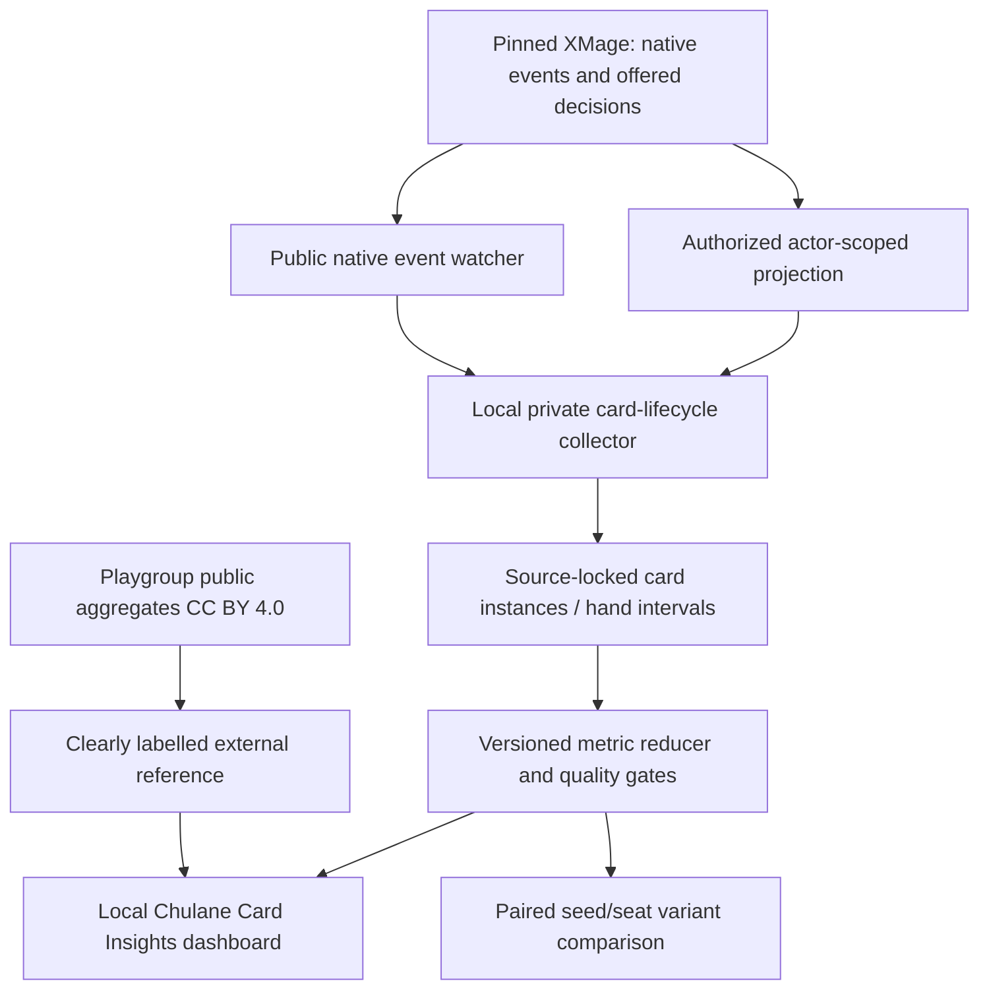

# Playgroup Live — Phase 7: Card Insights and Chulane measurement specification

**Date:** 2026-11-08. **Lab source lock:** main@79b549ba576d5cc612b4ab92cd17b28ebe25d0e6. **Scope:** public Playgroup data, existing XMage metrics, proposed player-safe lifecycle instrumentation, card efficacy, sampling, interpretation and dashboard. **Status:** documentation / audit only; no new XMage games, collectors, endpoints or interface implemented.

**Product decisions:** The only active personal deckbuilding priority is Chulane (separate draft PR #1134, still unmerged at the source lock). Four players standard, six maximum; eight only isolated feasibility research. The pinned XMage engine remains sole Rules authority. No data/collections/** read, no private deck uploaded to Playgroup. Public data are exploratory, not results of our specific deck.

## 1. Executive conclusion

Playgroup's Card Atlas / Card Insights provides an excellent model for **what to measure**, not a direct ranking of our Chulane cards. The Lab already records **per-seat native cast offers, selected casts, first-cast own rounds, commander first casts, mana failures, interactions and complete-game winners**. It does not currently have a proved, end-to-end per-physical-card hand-entry/exit event ledger.

The public XMage event watcher deliberately **does not name hidden library-to-hand cards**. Hand-age, actual drawn-to-played and dead-draw statistics cannot be reconstructed from that public event log alone; a future local actor-authorized instrument is required. Its output must never leak to another player's frame, a spectator or public replay.

**Recommended path:** accurate source-locked 4P Chulane lifecycle metrics → privacy/quality gates → Card Insights dashboard → paired 4P deck-variant comparisons → separately qualified 6P. Every statistic needs numerator, denominator, time coordinate, sample, source, censoring and uncertainty.

## 2. Public Playgroup findings (EXTERNAL AGGREGATE, not our deck)

Source [Chulane commander page](https://playgroup.gg/commanders/2143-chulane-teller-of-tales), stated full refresh 2026-11-07:
- 2,094 recorded games; **published 36% win rate**, 770 wins and 1,304 losses shown. These top-line figures do not themselves reconcile the denominator, so report the provider's value without silently inventing missing outcome classes.
- Mean winning turn about **8.4** where a turn was recorded.
- Seat 1: **45.33% in 674**; seat 5 **16.28% in 43**; seat 6 **42.86% in only 14**. The 6P/sixth-seat rate is highly uncertain.
- The global Chulane archetype sample is landfall-heavy and rated below average on tokens; **our own creature-bounce/Clue deck need not resemble that population**.
- Commander-specific associated inclusion lifts include Bloom Tender +14.8pp (73 games), Cloudstone Curio +12.8pp (32), Shrieking Drake +3.3pp (97). These compare different player/deck populations and are **not causal add-card recommendations**.

Global **Card Atlas** snapshots from 2026-11-08:
| Public card | Brought | Ever drawn | Entered battlefield | Drawn → played, page | Median first cast |
|---|---:|---:|---:|---:|---:|
| [Academy Manufactor](https://playgroup.gg/cards/academy-manufactor) | ~5,916 | 1,469 | 1,088 | 74% | turn 5 |
| [Psychosis Crawler](https://playgroup.gg/cards/psychosis-crawler) | ~4,523 | 1,428 | 728 | 51% | turn 7 |
| [Chulane as a regular card](https://playgroup.gg/cards/chulane-teller-of-tales) | 587 | 157 | 96 | 61% | turn 6 |

The **Chulane card page** primarily measures Chulane included in the 99 of other decks, **not** the command-zone lifecycle of a Chulane commander. Do not confuse it with the commander stats page. Playgroup's on-curve figure is “cast no later than the own turn matching mana value” (early ramp also counts); its hand age is median drawn-to-cast delay among cards actually cast. It reports card win gaps as **correlation**, never attribution.

[Card Atlas](https://playgroup.gg/cards) describes frequency and pilot-concentration gates and a confidence-adjusted lower-bound ranking. Threshold wording differs between indexed page generations; verify current values when consuming the source rather than hardcoding any Playgroup sample threshold as our own. Player/card percentages on some pages are rounded and may mix subcohort denominators: **our product must explicitly expose both numerator and denominator**.

[About/data methodology](https://playgroup.gg/about): card actions exist for Playgroup **Live** seats, not paper games recorded by their tracker. The source mix is mainly casual/mid-power Commander and not an all-Commander census. [Legal](https://playgroup.gg/legal): aggregated statistics CC BY 4.0 with attribution; raw events, proprietary code and Wizards card images are **not licensed by that statement**. The [public Swagger API](https://playgroup.gg/api-docs/index.html) does not demonstrate a public per-card private game event export. No authenticated/raw Playgroup data accessed.

## 3. Lab feature inventory (CODE_DERIVED, not tested in this PR)

| Source | Existing data/behavior | Missing for full Card Insights |
|---|---|---|
| scripts/pilot_decision_report.py | per-card report v3: offered_castable, cast, cast_in_offer_window, cast_on_opponent_turn, cancelled_payments, first_cast_round; per-seat outcomes and commander first-cast own round | No physical hand entry/draw observation. “Offered” can recur across priority windows and **is not draw count** |
| docs/DECK_VARIANT_WORKFLOW.md | explains cast_rate vs cast_share, own-turn round, source and version matching, paired variants, cluster intervals and underpowered outcomes | No generic card-life collector |
| scripts/pilot_report_samples.py | only completed game seat-casts and win status | “Casted at least once” ≠ resolved/entered battlefield |
| scripts/card_synergy_report.py; scripts/threat_report.py | card pair and opposing card win-loss **association** with small minimum sample threshold | Confounding, multiple testing, no causal proof |
| src/commander_lab/models/diagnostics.py | CardPerformanceInstrumentation schema has drawn, kept, played, dead_in_hand and average_turn_played **fields** | A schema is not proof that these fields come from native, fully traced real games |
| engine-bridge/.../XmagePublicEventWatcher.java | native public zone changes, SPELL_CAST, triggers, created tokens, damage/life/terminal; hides private card name on library→hand | Deliberately insufficient to identify each drawn card publicly |
| engine-bridge/.../XmageFullGameStateRedactor.java | actorView/private hand where native authorization permits; publicView hides hands | Requires local actor-only lifecycle instrumentation and persistent per-event entitlement |
| docs/performance/PILOT_RANK_SENSITIVITY_PROTOCOL.md; scripts/rank_sensitivity.py | 4P seed-blocked four-seat rotations, ranking sensitivity and precision | Apply to Chulane after current baseline is integrated; no new measured run |

**Key distinction:** current per_card_version=3 first_cast_round is the seat's **own turn count**, while commander_first_cast_turn is the global turn. Never mix them; extra turns and eliminated players require an actual observed clock. Split/adventure card canonicalization and return-to-hand recasts require explicit card identity discipline.

## 4. Measurement architecture (PROPOSED, not implemented)



The collector, reducer and dashboard are future components; the diagram does **not** depict a current implementation. Never send a raw actorView, decklist or replay seed to a spectator. Native legal cards and timestamps stay inside permitted game/seat contexts. If native source attribution or identity cannot be reconstructed reliably, publish **UNKNOWN**, not a guessed card identity or effect.

### Data contracts to version

**GameRun:** game_id, deck_hash_by_seat, engine_sha, lab_sha, pilot_policy, 2..6 seats, pod_id, seed, start_seat, terminal_status, stop_reason, winner_seats, turn sequence, checked event/decision offsets, integrity digest.

**SeatEpisode:** game_id, seat, actual own_turn_index, starting kept seven and land/role counts (seat private), mulligan_count, first commander cast, win credit, actual game status.

**CardInstance (private):** opaque local card instance id, canonical card/face name, actor-authorized seat, zone-change epoch, copy/token flag, source deck, authorization status at event time. Do not broadcast native UUIDs.

**CardLifecycleEvent:** monotonic event sequence, game/seat, card token, zone_from/zone_to, entry/exit reason, global turn, own turn index, phase/step, decision offset, public event offset, native source link quality, selected action vs stack cast vs resolution vs battlefield.

**HandInterval:** card instance, entry_kind (kept opening, drawn, tutored, bounced/returned, other), entry own turn, exit own turn, exit_kind (cast, discard, exile, shuffle, death, ended, other), exposed native legal cast opportunities, right-censored flag.

**ActionOpportunity:** unique decision_id and offset, seat/own turn/card token, native offered cast, choice, acceptance, cancelled mana, resolution outcome. Repeat offers across many priority passes are **not independent draws**.

**EffectObservation:** source card token, native event type (draw, extra land, Clue/Food/Treasure token, damage, replacement, removal, terminal), source attribution quality DIRECT/INDIRECT/UNKNOWN. A guessed synergy bonus is MODELLED, not direct native effect evidence.

**MetricPublication:** schema/metric version; exact counts N and n, estimator/CI, observed games/seed blocks/pods, qualified source/pin, strata, censoring, exclusion reasons, evidence label and optional Playgroup source URL/as_of/CC BY 4.0 attribution.

## 5. Exact metric dictionary and denominators

| Code | Metric | Definition and interpretation | Current status |
|---|---|---|---|
| M01 | Deck inclusion | Eligible Chulane games with the card in the **same exact deck_hash**, divided by all games for that hash | Inputs available; per-game summary |
| M02 | Seen / drawn | Distinct card-in-hand **entries** from library or kept opening seven; show source type and separate command-zone commander. Do not count bounce as new draw | Requires actor-private lifecycle |
| M03 | Draw-to-cast | Distinct seen physical card episodes with first **accepted native spell cast reaching stack** divided by all seen eligible card episodes, with censoring | Not currently derivable from public log |
| M04 | Draw-to-battlefield | Among seen cards, how many **actually entered battlefield**, with non-cast cheated plays separately identified | Native zone link gap |
| M05 | Hand dwell | **Median own-turn difference from hand entry to native cast**, among cast-hand intervals; same turn = 0. Report n and **separately** number still held/censored | Not currently measured end-to-end |
| M06 | Dead draw / hand reasons | Fraction still in hand at game end, actually discarded/exiled before casting, and **castable-but-held** among native opportunities; these are distinct. Held counterspell may be correct | Requires intervals and offered choice classification |
| M07 | Cast on curve | Among eligible **first actual nonland casts**, count first own-turn index <= reference **mana value**; denominator eligible first casts, not all games or all draws. Break out early vs exactly MV | First cast own round exists; metric reducer gap |
| M08 | Offered-to-cast | Distinct seat-game-card spells with at least one eligible offer vs at least one native accepted cast; existing per-card v3 cast_rate is **per counted offer**, not per draw | Existing proxy, episode reducer required |
| M09 | Commander timing | Chulane first own turn cast, recasts, tax and time off board, stratified by seat and pod | First cast available; recast lifecycle gap |
| M10 | Board survival | Number of instances still on battlefield at terminal / number that reached battlefield; exits, bounce, sacrifice and removal tracked separately | Partial public events |
| M11 | Direct card contribution | Native-attributed Chulane trigger draws, extra lands, Clues/Treasures/Food, damage, commander damage, verified win trigger; **unknown if no native source tie** | Partial event watcher; source attribution gap |
| M12 | Cast vs library win association | Difference between games where card **cast** and games where it **stayed in library**, within fixed Chulane variant/pod/seat. Descriptive / confounded, not a causal “effect” | Old reports can show cast vs not cast; library cohort unproven |
| M13 | Variant comparison | Matched baseline vs candidate Chulane games, same public opponent pods, seeds and seat rotations; **paired win-credit difference with interval**, failures disclosed | Existing comparator, no new result |
| M14 | Opening hand | Kept 7, initial lands/ramp/protection and mulligans, Chulane cast timing and observed win credit; separate from hindsight-selected hands | Mulligan tools partly exist; lifecycle join gap |
| M15 | Synergy events | Creature spell cast while Chulane present -> native draw/land; Whitemane Lion recast; Manufactor token replacement; Psychosis Crawler damage; alternate win trigger | Specific native source-link tests needed |
| M16 | Win credit | Sum terminal winner credit / completed valid **Chulane seat-games**, with 4P vs 6P **separate**, draws/multiwin/failed games shown | Winner and game result available |
| M17 | Resilience | Wipes faced, Chulane tax/recasts, protection, number of permanents lost, time-to-rebuild; avoid effect-guessing | Partial, build source-linked report |

### Important edge cases

- **Hand time:** Kept opening hand starts at episode index 0. A bounce returning **Whitemane Lion** opens a new hand interval, **not a fresh draw**. A card never cast before game end contributes to the **censored/competing exit group**, not the cast-only median; a correct counter held for lethal protection is not automatically “dead”.
- **Own-turn clock:** First cast on an opponent turn is allowed for instants/flash; record actual owner own-turn ordinal plus phase and global turn. Extra turns, control another player, eliminated seats are not approximated by global_turn/player_count.
- **On curve:** A 3-MV nonland first cast on or before the player's 3rd own turn counts as early/on-time; document reference MV on alternate modes/costs. X spells, split/adventure/rooms, zero-MV cards and Commander tax require explicit, versioned denominator/exclusion conventions. A delayed interaction spell is not necessarily bad play.
- **Played vs cast vs resolved:** Lands are played, not cast. A spell can be countered. A creature may enter battlefield without being cast. Copies/tokens are not copies in a physical 99-card deck. Count all stages separately.
- **Commander in command zone** is treated as permanently *available*, **not drawn from the library**. Do not use the Card Atlas "Chulane included in the 99" metrics for first commander-cast analysis.
- **Win credit:** report terminal-only outcomes and preserve explicit handling of draws, failed games, multiple winners and no-winner results. Use the convention already locked by the paired comparator for A/B; don't mix 4P natural baseline **25%** with 6P **16.67%** as though identical.
- **Opportunity vs decision:** repeated legal options over multiple priority passes are not independent sample units. A selected cast that failed mana payment must not be counted as a resolved spell or card effect.

## 6. Statistical interpretation and confidence gates

**Three fundamentally different questions:** (a) descriptive frequency, e.g. draw-to-play; (b) observational association, e.g. win when cast; (c) intervention, e.g. replace one card in Chulane with another and compare **paired full games**. Only (c), with careful design, can justify changes as causal *within the matched simulator context*.

| Status | Conditions | Permitted output |
|---|---|---|
| DIRECT_OBSERVED | Exact native source, denominator, source lock, actor rights and complete relevant events | Counts, rate, interval |
| EXPLORATORY | Truthful observations but few distinct games/seeds/pods or broad CI | Provisional observation, no card-cut ranking |
| CORRELATIONAL | Cast-vs-win, opening-card-vs-win, synergy lift without randomized assignment | Association and bias explanation, never “card added X% win rate” |
| CENSORED | Unfinished hand interval, early game stop, elimination or unplayed card at terminal | Separate censored/exits, do not mislabel useless |
| UNKNOWN | No authorized source identity, no exact numerator/denominator or unjoinable event | Withhold metric and state reason |
| INVALID | Privacy leakage, event loss, source mismatch, malformed action or nonterminal claimed as terminal | Fail closed; no KPI claim |
| VARIANT_EVALUATED | Predeclared matched pods/seeds/rotations, confidence/power review and integrity | A/B finding with uncertainty; no clear difference != equivalence |

Use **Wilson 95% intervals** for independent per-game binary estimates; account for shared seed/pod/seat rotation in variant comparisons via existing **cluster-robust/paired** machinery or a cluster bootstrap. Repeated triggers/options from one game are not independent samples. Restrict card comparisons by deck hash, pilot policy, starting seat, opponent archetype, game horizon and 4P/6P mode. Report exact n, N, number of unique games, seeds and pods; show failed/censored counts.

**Sample gating:** Ten games = exploratory at best; don't treat a magic threshold as universal. Existing docs/performance/PILOT_RANK_SENSITIVITY_PROTOCOL.md uses **at least 40 seed blocks per 4P pod with four seat rotations** for its ranking question. Use existing docs/DECK_VARIANT_WORKFLOW.md to preregister a primary endpoint, apply cluster adjustments, sequential looks and Holm multiplicity correction. Single-card winshare shifts smaller than detectable differences remain **UNDERPOWERED** despite a positive noisy observed lift.

**External confounding:** Playgroup data mix different pilots, decklists, game lengths, archetypes and opponents; positive cast-vs-library gaps reflect survival and mana access as well as card power. Their published 36% Chulane win rate is **not** our candidate's measured win rate; sixth-seat n=14 cannot calibrate 6P. Opening-hand winner associations have selection bias. Public CC BY 4.0 stats are hypotheses and display benchmarks, never tuning data without separately reviewed fit.

## 7. Proposed Chulane dashboard and report

```text
CHULANE CARD INSIGHTS | 4P | exact deck hash | XMage pin | pilot version
[ok / attempted games] [win-credit + interval] [first commander cast own turn]
[draw-to-cast n/N] [hand dwell median + censored n] [on-curve n/N]

Card | seen n | native casts | first cast own turn | hand intervals
     | opportunities | direct native effect | cast-vs-win association (warning)

Engine insights:
  creature spells with Chulane | verified draws | lands from hand to board
  bounce-recast count | Clues, Foods, Treasures generated | wipes survived
  Psychosis Crawler actual damage | Mechanized Production native win checks

Experiment:
  exact swap A/B | paired pods/seeds/all seats | Δ win credit with CI
  separate 4P and qualified 6P | resource/failure and pilot sensitivity
```

These are design components, **not existing dashboard data**. The public Card Atlas's high-level comparisons can be shown in a distinct EXTERNAL REFERENCE section with attribution; **never merge** the providers' numerator/denominator populations into our local metric row.

## 8. Recommended execution stages

| Priority | Deliverable | Required proof |
|---|---|---|
| P0-A | Baseline local Chulane **4P** decision report using existing pilot_decision_report.py after PR #1134 is integrated and stable | Exact deck hash, source, engine pin, seat, non-ok rows, cast-offer definitions |
| P0-B | Native **actor-private** lifecycle record: kept opening, real draw, bounce return, first cast, zone exits | No cross-seat/spectator private identity; stable per-instance event join |
| P0-C | Versioned metric reducer and dictionary from M01–M17 | Numerator/denominator consistency, censoring and UNKNOWN tests |
| P1-A | Exact Chulane source event attribution (creature cast trigger, land effect, token and damage sources) | Direct native source match or UNKNOWN; no text-heuristic invention |
| P1-B | 4P Card Insights view with counts, interval, table and time plots | Accessible, local-only, permission-scoped |
| P1-C | Paired 4P variants with preregistered winshare and seat rotation, existing comparator and rank sensitivity | CI/power, no false “equal” conclusion; no deck changes from association alone |
| P2 | Separate 6P rollout (CPU/RAM/replay/hidden info) | Six-seat qualification; 7+ rejected |
| P2 | Optional local cache of public Playgroup aggregate card pages | CC BY 4.0 source/date, no API access to private deck data |

**Highest priority:** get truthful denominators and card object lifecycles before generating a flashy “weakest cards” score. A reactive Counterspell can be correctly held for multiple turns; draw-to-play alone cannot label it underperforming.

## 9. Current status / open limitations

**PUBLIC_CARD_RESEARCH = COMPLETE.** **SOURCE_AUDIT = COMPLETE.** **METRIC_DICTIONARY / DESIGN = COMPLETE.** **LOCAL_CARD_LIFECYCLE_COLLECTOR = NOT_IMPLEMENTED.** **CURRENT CHULANE EXACT-DECK RESULT = NOT_RUN.** **PLAYGROUP_PRIVATE_CARD_DATA = NOT_ACCESSED.** **6P SEMANTIC_REPLAY = UNQUALIFIED** (the specific tape schema remains 2–5P). No causal card-importance result is claimed.

**Companion test matrix:** [Chulane Card Insights qualification cases](PLAYGROUP_LIVE_PHASE7_CHULANE_CARD_INSIGHTS_TEST_MATRIX_20261108.md).

## 10. Primary sources

**Playgroup official (retrieved 2026-11-08):** https://playgroup.gg/cards ; https://playgroup.gg/commanders/2143-chulane-teller-of-tales ; https://playgroup.gg/cards/academy-manufactor ; https://playgroup.gg/cards/psychosis-crawler ; https://playgroup.gg/cards/chulane-teller-of-tales ; https://playgroup.gg/playgroup-live ; https://playgroup.gg/about ; https://playgroup.gg/legal ; https://playgroup.gg/api-docs/index.html .

**Lab, exact source lock:** scripts/pilot_decision_report.py ; scripts/pilot_report_samples.py ; scripts/card_synergy_report.py ; scripts/threat_report.py ; src/commander_lab/models/diagnostics.py ; docs/DECK_VARIANT_WORKFLOW.md ; scripts/rank_sensitivity.py ; docs/performance/PILOT_RANK_SENSITIVITY_PROTOCOL.md ; engine-bridge/src/main/java/org/commanderlab/xmage/XmagePublicEventWatcher.java ; engine-bridge/src/main/java/org/commanderlab/xmage/XmageFullGameStateRedactor.java ; src/commander_lab/engine/rules/full_game.py ; src/commander_lab/semantic_replay/tape.py ; config/rules_engines.json.
