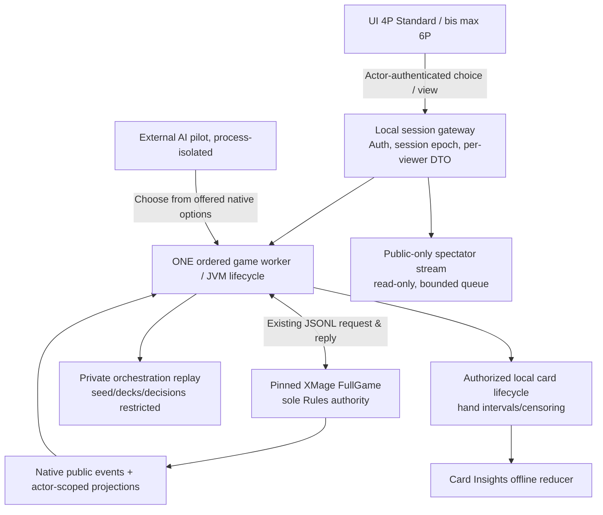
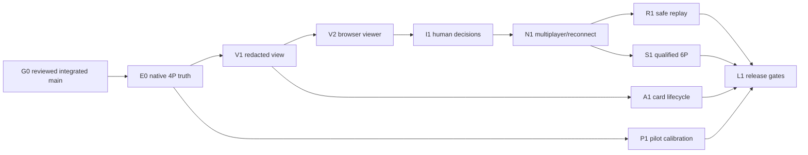

# Playgroup Live — Phase 8: Gesamtaudit, Praxistest-Strategie und Integrationsroadmap

**Stand:** 2026-11-08 · **Repo:** `moeendres-png/commander-playtest-lab` · **Evidenzstand:** `main@79b549ba576d5cc612b4ab92cd17b28ebe25d0e6` · **Artefaktart:** source-locked research, integration decision record, test and release planning. **Keine laufende Browser-UI, kein neues Lastspiel und kein neuer Replay-Collector wurden in Phase 8 implementiert oder ausgeführt.**

> **Integrationsnotiz (2026-11-08, nach Review und Merge):** Dieses Dokument beschreibt in §0 und §2 den Stand `main@79b549ba5`, als
> #1134–#1141 noch offene Drafts waren. Dieser Stand ist überholt: #1134 (Chulane-Fokus, `b0ebdac13`), #1135 (6-Spieler-Grenze,
> `5bf8e93d1`), #1136 (`afda65b62`), #1137 (`46d571848`), #1138 (`0fd421d34`), #1139 (`4d5f0ba62`), #1140 (`473e581d7`) und #1141
> (`fc29cd3b6`) sind nach unabhängigem Review gemergt. Beim Review korrigiert: #1135 verbot jede 8-Spieler-Arbeit und widersprach damit
> der Owner-Entscheidung (isolierte 8P-Machbarkeitsforschung ist erlaubt, kein Produktpfad); #1137 nannte den Live-Pin im Fließtext statt
> auf `config/rules_engines.json` zu verweisen; #1141 nannte `per_card_version` 3, wo `main` Version 4 ausgibt (3 führte `first_cast_round`
> ein). Maßgeblich für den Live-Pin bleibt allein `config/rules_engines.json`. Alle Aussagen dieses Dokuments bleiben Forschung und
> Planung: `AUDIT_DONE` ist nicht `IMPLEMENTED`, `TEST_SPECIFIED` nicht `TEST_RUN`. Es wurde keine Playgroup-Funktion implementiert.

## 0. Bindende Owner-Entscheidungen und Definition von „fertig“

- **Alleiniges aktives Owner-Deck:** Chulane, Teller of Tales. RogShai nur als historisch notwendige Regressions-/Provenienzreferenz; keine neue aktive RogShai-Optimierung. Die Umsetzung des Fokus liegt derzeit in **Draft-PR #1134**, nicht automatisch auf `main`.
- **Spielergrenze:** **4 Spieler Standard, 6 Spieler dauerhaft produktives Maximum**. 2/3/5/6 dürfen nur in individuell qualifizierten Lanes laufen. 8-Spieler-XMage höchstens **isolierte Forschung**, kein Simulator-Sitz, kein Gateway-Endpoint, keine Benutzeroberfläche, kein 7+-Benchmark produktiver Runs.
- **Regeln:** Alle legale Aktionen, Stack, Priority, Trigger, Kosten, verdeckte Zonen, Sieg und RNG kommen aus dem **gepinnten XMage** (`config/rules_engines.json`); Pilot und Browser wählen nur die **wirklich angebotenen native Decision Options**. Keine generische erstbeste Aktion, kein Auto-Pass bei Fehler, kein Rule-Fallback.
- **Kosten:** Für den Kernweg **keine bezahlte API, keine neuen Abonnements, keine Cloud-Pflicht, keine kostenpflichtige Diensteinstufung**. Für Entwicklungs- und Solo-Simulation lokal vorhandenes XMage/Python/SQLite/FastAPI und freie Browsertechniken bevorzugen. Lokale Hardware-/Stromkosten und ein später optional extern erreichbarer Multiplayer-Server sind **nicht buchstäblich gratis**; solche Hostingkosten sind nicht zugesagt oder in diesem Plan verpflichtend.
- **Schutz:** Keine privaten `data/collections/**` Dateien lesen, veröffentlichen oder zu Playgroup senden; keine Raw-Bridge-`export_replay`-Datei, Decklisten, Seeds, fremde Handsichten oder private Entscheidungsfenster an Zuschauer übertragen. Keine neuen Engine-Pins, Repository-Eröffnung oder geschützte CI-Gates ohne zuständige Freigabe.
- **Begriffe:** `AUDIT_DONE` ist **nicht** `IMPLEMENTED`; `CODE_DERIVED` **nicht** `RUNTIME_PASS`; `TEST_SPECIFIED` **nicht** `TEST_RUN`; historische Runs **nicht** automatisch CURRENT_HEAD-qualified. „Fertig“ wird je konkretem Schritt mit ausführbarer Evidenz, Hashes und Negativtests belegt.

## 1. Phase 1–7: Gesamtbefund, keine Vermischung von Produkt und Forschung

| Phase / PR | Gesicherte/inspezierte Erkenntnis | Übernehmbar in Lab | Offen / kein Beleg |
|---|---|---|---|
| **1 / #1135** Architektur, Code, Lizenz | Playgroup: Browser/WebGL, Scryfall-Karten, LiveKit AV, Redis-Chat, public REST/OpenAPI, serverseitig gemeldete Sichttrennung, 2–6; kein verifizierter offizieller kompletter Open-Source-Code | **UX-/Integrationsreferenz**, eigene frei lizenzierte Implementierung; Produktlimit separat festhalten | Browser-JS-Framework, Originalcode, interne Server-Synchronisierung **UNKNOWN** |
| **2 / #1136** Regeln | Playgroup: umfangreiche manuelle Bedien-/Zonenhilfen, keine nachgewiesene vollständige Regeldurchsetzung. Lab: native XMage-Regeln, offered decisions, redacted views | **XMage behalten**, UI nur Anzeige/Optionsauswahl; 38 Regelkategorien, 22 geplante Prüfungen | Keine neue Live-4P/6P-Kartensuite für alle 38 Kategorien |
| **3 / #1137** Kapazität | XMage upstream bewirbt hohe Spielerzahlen; Lab begrenzt Java/Python operativ auf 6. Historische 4P/6P-Messungen weisen stark vom Pod abhängige Kosten auf; 6P schwere Stacks und Telemetrie-RAM-Tails | **4P zuerst**, 6P separat unter RAM/CPU/Replay-Qualifikation, 8P nur analytisch/statisch | Kein aktueller kontrollierter 4P/6P-A/B-Skalierungstest, **keine 8P-JVM-Messung** |
| **4 / #1138** Battlefield | Playgroup-Zonen, Drag, Stack, Hotkeys, Tablet/Zoom, Token-Clustering; vier eigene statische SVG-Konzepte | **Originale 4P/6P-Screens**; Chulane-Token visuell gruppieren, Objekte in Engine getrennt halten | UI weder implementiert noch real usability-/browsergetestet |
| **5 / #1139** Sparring/Piloten | Playgroup 21.480 Interaktions-Casts/6.934 Spiele, Kategorien 58/19/13/7/3, Wipe-Relativgewicht 2,5 bei 3+ Kreaturen. Lab besitzt reale Mana-/Counter-/Removal-/Threat-Heuristik | Nur **schwache externe Priors** und lokale Opportunitätskalibrierung; 25 Chulane-Testfälle | Cast-Verteilung **ist keine** Antwortwahrscheinlichkeit pro Priority-Fenster; keine neue Policy getestet |
| **6 / #1140** Multiplayer/Replay | Lab: JSONL-Bridge, native Decision ID, PublicEventWatcher, actorView/publicView, technische Replay-Exporte; keine Browser-Session-Fanout-API. 120s native Decision-Deadline, Replay-Tape 2–5P | Ein authentifizierter single-owner **Spiel-Worker/Gateway**, Zuschauer nur öffentliche Sicht, Reconnect mit Session-Epoch+Resync | Kein WebSocket-/HTTP-Browsergateway, kein Reconnect-/Spectator-E2E; 6P-Semantic-Tape **GAP** |
| **7 / #1141** Card Insights | Lab-Reporter v3 zählt native Offer/Cast/First-Cast-Round, Win-Outcome; native PublicEventWatcher verbirgt private Card-Draw-Identitäten. Playgroup globale Kartenfunnel und Chulane-Sitzstatistiken vorhanden | Actor-sichere **Card-Lifecycle-Erfassung**, eindeutige Nenner, Zensierung, paired-seed Variantvergleich; 17 Metriken, 32 Prüfungen | Kein kompletter Card-Instance/Hand-Dwell-Collector, keine kausale Karteneffekt-Aussage |

**Datenprovenienz:** Die Phasenberichte sind die Quelle konkreter externer URLs und der inspizierten Quellpfade. Diese Masterroadmap behauptet **keinen** zusätzlichen Playgroup-Live-DevTools-Test, keine geladenen proprietären Bundles und keine neuen vollständig gespielten XMage-Partien.

## 2. Aktueller PR- und CI-Integrationsstand: 2026-11-08

**Live aus GitHub geprüft:** Main `79b549ba576d5cc612b4ab92cd17b28ebe25d0e6`; alle PRs **#1134–#1141 offen und Draft**. PR #1123 war bereits gemergt. Aktuelle PR-Heads unten. Ein positiver Scope-/Dokumentationscheck zählt nicht als `real-4p-smoke`: letzterer wurde in diesen Branch-Läufen **übersprungen**.

| PR | Inhalt | Current-head Prüfung | Handlung |
|---|---|---|---|
| #1134 | Chulane-only Owner-Fokus + Deckbau-/Agent-/README-/Workflowänderungen | 11 PASSES; **`ci-definition-integrity-shadow` FAIL** | P0: unabhängige Prüfung der **neuen Testdefinition `tests/unit/test_deckbau_chulane_focus.py`** und ordnungsgemäßer Gate-Review. Nach erfolgreicher Freigabe erst mergebar |
| #1135 | Phase 1 + 6P-Owner-Grenze, Mission/Policy/README und Negativtest | 9 PASSES; **`ci-definition-integrity-shadow` FAIL** | P0: unabhängige Prüfung der **neuen Testdefinition `tests/unit/test_owner_player_cap.py`** und Gate-Review; kein Umgehen der Schutzlogik |
| #1136 | Phase 2 | Scope, Security, Infra, Quality, Integritäts-Shadow grün | Dokumentationsreview und gegebenenfalls normaler Merge |
| #1137 | Phase 3 | wie #1136 grün | Dokumentationsreview und gegebenenfalls normaler Merge |
| #1138 | Phase 4 | wie #1136 grün | Review auf SVG-/UI-Urheberschaft, keine produktive Implementierungs-PASS behaupten |
| #1139 | Phase 5 | wie #1136 grün | Dokumentationsreview; keine ungeprüfte Pilotänderung |
| #1140 | Phase 6 | wie #1136 grün | Privacy-/Viewer-Gateway-Konzept überprüfen |
| #1141 | Phase 7 | wie #1136 grün | Metrikdefinitionen und Zensierung prüfen |

Die genaueren **offiziellen GitHub Job-Logs** zeigen als Ursache der beiden Shadow-FAILs `overall_classification: GATE_DEFINITION_CHANGED_REVIEW_REQUIRED`, und ausschließlich die jeweils neu hinzugefügte Testdefinition. Es ist **kein** nachgewiesener XMage-Rules-Failure; gleichzeitig ist es ein **echtes vorgeschriebenes Review-Gate**. Weder Tests entfernen noch CI umschreiben, nur damit es grün wird.

**Merge- und Konfliktschutz:**
- #1134 und #1135 ändern beide **`README.md`** und sind vom heutigen `main` **diverged**: vor dem Merge die aktuellen Dateiinhalte, Konflikte und Owner-Entscheidungen neu abgleichen.
- #1135 ändert `docs/PROJECT_MISSION.md` und `docs/OPERATIONAL_SIMULATION_POLICY.md`. Auf Main steht darin teilweise noch eine **veraltete 2–5P/6P-Stretch-Beschreibung**, obwohl Java/Python inzwischen 2–6 zulassen. Erst nach qualifiziertem Policy-Abgleich als behoben bezeichnen; das 6P-Maximum ist **keine** automatische 6P-Laufzeitzertifizierung.
- #1136–#1138 sind gegen älteren Main SHA erstellt und inzwischen `diverged`, haben aber eigene Forschungsdateien. #1139–#1141 waren bei letzter Prüfung auf Main `ahead`. Erneut mergen/rebasen nur nach tatsächlicher Diff- und Gate-Prüfung.
- Owner hat Claude separat ermächtigt, die PRs nach Review und abgeschlossenen Gates **selbstständig zu finalisieren/mergen**. Phase-8-Workstream soll keine parallelen Änderungen an #1134/#1135, `AGENTS.md`, Rules-Pin, Sealed Evidence oder deckkritischen Dateien vornehmen.
- CI `real-4p-smoke`, `h4-xmage` und verwandte Integration waren auf den recherchierenden PRs **skipped**. Kein neuer Runtime-PASS daraus abzuleiten.

## 3. Priorisiertes Risiko-Register

| ID | Risiko / Wahrscheinlichkeit × Schaden (qualitativ) | Blocker? | Minimale Entkräftung |
|---|---|---|---|
| R1 | **P0 Hoch:** Fremde Hand-/Library-Identität oder Raw-Deck/Seed im Spectator, Event, Replay, Webcache | **Release block** | Principal-scoped serialize-then-byte-inspect negative tests, temp look grants, CR 723, face-down und postgame; kein Raw-Replay an Client |
| R2 | **P0 Hoch:** UI/Gateway dupliziert oder fabriziert native Rule-Aktion; stale Decision/actor mismatch | **Release block** | Nur XMage-offered `option_id`, Decision/epoch/nonce, ein Game-Worker, Off-menu/stale/double-submit rejection |
| R3 | **P0 Hoch:** Chulane-Fokus bzw. Owner-6P-Policy divergiert wegen #1134/#1135 CI-Review und README-Konflikt | **Merge block** | Independent CI-definition review, alle Eigentümer-/Source-Gates, Head-Neutests und tatsächlicher Merge-Abgleich |
| R4 | **P0 Hoch:** Browser-Reconnect überschreibt aktiven Native-Decision-Timeout oder interpretiert Engine-Crash als Fortsetzung | **Release block** | 120s Deadline nicht verlängern, reconnect mit frischer Auth und writer lease; fail closed after timeout, keine First-Option/Auto-Pass |
| R5 | **P0 Hoch:** 6P-Kompatibilität suggeriert voll qualifiziertes Replay trotz 2–5P-Tape-Vertrag | **6P replay block** | Separate Manifest-/Principal-Änderung und 6P-Source-Locked Replay-Tests; ggf. 6P ohne Replay nur klar begrenzt |
| R6 | **P0 Mittel/Hoch:** Datenbank-/Replay-/Event-Wachstum bei großen Clue-/Trigger-Ketten | **capacity block** | Begrenzte SQLite-gestützte Spools, Snapshotstrategie, CPU/RSS/Disk/GC messen, 4P zuerst; nachgewiesene 6P-Tails als Warnung |
| R7 | **P1 Mittel/Hoch:** Java-Bridge ist synchroner JSONL-Prozess, kein fertiger Web-Multiuser-Server | **implementation dependency** | Gateway-Design und Auth/actor-view-Kommandos; nie rohes JSONL über Web exposen |
| R8 | **P1 Mittel/Hoch:** Karten-Insights rechnen falsch, wenn `offered_castable` als „gezogen“ oder Handende als „tote Karte“ gilt | **analytics block** | Native Card-Lifecycle, eigene Cast-/Return-/Exit-Episoden, exakte Nenner, Zensierung |
| R9 | **P1 Mittel:** Playgroup-Interaction-Mix wird als pro-Turn-Wahrscheinlichkeit missbraucht; Phantom-Gegneraktionen | **pilot gate** | Empirische echte XMage-Angebotsnenner, Priors zunächst aus, 4P paired Pilot-Tests |
| R10 | **P1 Mittel:** 4P-/6P-Visualisierung verdeckt Priority, Stack oder Chulane-Tokenobjekte | **UX gate** | Responsive Focus, 4P-Standard + separate 6P-Verdichtung, Token nur grafisch gruppieren, A11y-Tests |
| R11 | **P1 Mittel:** Causality-Schluss von `card played` korreliert mit Sieg auf Karten-Cut/Upgrade | **optimization gate** | paired-seed/seat-rotation, Cluster-CI, MDE/power, präregistrierter Endpunkt und Multiple-Testing |
| R12 | **P2 Mittel:** ungeprüfte WebGL-/LiveKit-/Cloud-Dienste erzeugen unnötige Fixkosten oder Closed-Source-Abhängigkeit | **scope blocker** | Erst lokal, native HTML/SVG/Canvas messen, optionales AV/Hosting ausdrücklich nicht voraussetzen |
| R13 | **P2 Mittel:** 8P-Forschung erweitert unabsichtlich Produkt-Schema oder schafft nicht qualifizierte Sitzrechte | **product gate** | Statischer UX-Vergleich/isolierter Mage-Nativ-Test, 7+/8P live und Job admission fail-closed |

Die Reihenfolge folgt **Schadensbegrenzung vor Feature-Dichte**, nicht nach visueller Auffälligkeit.

## 4. Empfohlene Architektur (nicht implementiert)

**Reuse before rewrite:** Start from existing `XmageFullGameDecisionController`, `XmageFullGameStateRedactor`, `XmagePublicEventWatcher`, `full_game.py`, `semantic_replay/tape.py`, `pilot_decision_report.py` and existing FastAPI tool server. Reusing a *tool server* does **not** magically yield secure browser session semantics; the read-only live observation adapter and human decision bridge are new, explicitly separate work.

**Protocol fundamentals:** per-seat auth; principal ≠ GUI focus; `decision_id`/offset for native options, `session_epoch` to fence stale writers, nonce to dedup, `public_event_offset` and `state_revision` for viewer resync. No undo/free zone move. Hidden identity filtered at gateway **before** serialization and fanout; public watcher cannot supply card-specific hand-dwell identities.

## 5. Integration roadmap: dependencies, gates, stopping points

Stages are **dependency order, not promised calendar dates or guaranteed delivery times**.

| Stage | Work package | Minimal usable artifact | Required upstream | Exit gate |
|---|---|---|---|---|
| **G0 – Merge hygiene** | Independent review + integration of #1134–#1141, #1142 Phase-8 documentation if approved | Up-to-date, conflict-reviewed `main`, known head/source hashes and Owner policy | Current PRs / Claude parallel work | No unresolved gate-definition FAIL, conflict, unauthorized source/pin, false runtime PASS |
| **E0 – Existing engine baseline** | Re-check representative actual 4P Chulane + public opponents at exact integrated head/pin; card facts/readiness; evaluate failure and 4P latency | Reproducible benchmark/evidence bundle | G0 + approved Chulane baseline + pinned jar | Valid terminal status, no illegal offer, no hidden leak; failures retained |
| **V1 – Read-only engine view** | Ordered single-worker adapter around JSONL; authenticated redacted *snapshot* and public event cursor; actor-only ephemeral state | Headless 4P read-only API, no browser auth bypass | E0 | Hidden-data negative tests, deterministic public projections, sync and bounded resource budget |
| **V2 – First visual viewer** | Own 4P Chulane board, three opponent HUDs, Stack/priority, hand (only seat owner), public event timeline, token grouping | **Watch a real XMage 4P simulation in browser** | V1, Phase-4 wireframes | 4P read-only end-to-end with real engine, displayed state reconciles with native |
| **I1 – Human/native interaction** | Offered options, cast/target/mode/mana/priority/pass; per-seat decision controller; actor IDs + timeouts | One real player can make legal 4P decisions alongside native AI pilots | V1+V2, Phase-2 test matrix | Off-menu/stale/duplicate/wrong-actor all rejected, stack and target behavior verified |
| **N1 – Multiplayer reliability** | Authenticated multi-seat sessions, role permissions, nonce + epoch, reconnect, spectator, event resync/backpressure | Stable authenticated 4P multiplayer including read-only spectator | I1, V1 | 120s fail-closed deadline, no ghost action, reconnect tests and bytewise privacy negative cases |
| **R1 – Replay** | Public-only historical snapshots/events, restricted internal native replay, participant scope, optional consented reveal | 4P public view replay; internal source-locked exact replay stays private | V1+N1; Bridge verifier and tape | Scope ACL, event timeline, exact source replay checks; no seed/deck dump |
| **A1 – Card Insights truth** | Local seat-authorized hand lifecycle + native card/effect source linking, time in hand and per-card metrics M01–M17 | Accurate 4P Chulane Insight table + Unknown/censoring states | E0+V1 or equivalent actor-safe local instrumentation | Native source provenance, no guessed draw/impact, failures and sample precision visible |
| **P1 – Opponent pilot calibration** | Existing legal-option pilot opportunity census; offline optional data priors and matched A/B 4P tests | No additional Rules paths; empirical AI quality report | E0 + Phase-5 casebook + measured game telemetry | Fail-closed, win-share/pilot ranking sensitivity, performance and privacy preserved |
| **S1 – Qualified six seats** | Capacity/memory, five opponent HUDs, native legal decisions, hidden info, multiplayer lifecycle and selected replay capability at 6P | Real 6P mode, **only in features specifically qualified** | E0+V1+I1+N1+chosen R1/A1 components | Exact 6P evidence including terminal, CPU/RSS, scope, UX; fix 2–5P tape gap before claiming 6P semantic replay |
| **L1 – Product release/maintenance** | Regression CI, free local setup, versioned docs, archive, performance profiles, privacy/retention and licensing | Supported local 4P experience; 6P only as gated capability | All release-critical earlier stages | Independent review, pinned qualification, no surprise fees, no native-rule regressions |

**Suggested first milestone:** **V2 = watch one actual 4P XMage match on our own board**. This validates engine→browser plumbing, Stack/priority display, redaction and Chulane busy-board UX **before** solving the harder human multiplayer and full Card Insights problem. The reverse order is technically expensive and unsafe.

**Feature dependencies as graph:**

**Preserve current workstreams:** Claude may be finishing its own independent tasks while these reports are integrated. No concurrent unilateral merge into shared policy, no forced change of Chulane snapshot or test fixtures, no touching `data/collections/**`. Owner's new Claude brief authorizes him to review/merge when approved gates actually pass; merely being granted authority does not waive the gates.

## 6. Practical tests: run now vs. implement later

The attached [Phase-8 acceptance matrix](PLAYGROUP_LIVE_PHASE8_INTEGRATION_TEST_MATRIX_20261108.md) defines **40 evidence-bound test cases**. Distinguish:

- **Existing-code proof immediately actionable after integration:** representative native 4P full games under pinned XMage, Chulane readiness, scenario legality/hidden frame audit, 2–6 admission/7+ rejection, existing replay verifier, pilot decision reports, batch CPU/RSS.
- **New-feature tests blocked until code exists:** browser gateway auth, principal-scoped arbitrary-time view, spectator WebSocket/SSE, network reorder/duplication/reconnect, browser decision submission, public timeline playback, full card-hand lifecycle collector, 6P tape playback.
- **8P:** only theoretical resource/cardinality or isolated upstream Mage native feasibility if expressly scoped; not a newly permitted operational game test.

**Test environment:** Run **local/offline** and source lock `Lab SHA + XMage pin + Bridge jar hash + deck hashes + seed + pilot + OS/JDK + CPU/RAM`; public fixture decks unless Chulane local fixture is explicitly authorized. Persist `status`, failure reason, terminal, event/decision digests, observed witnesses, skipped reasons and peak process/disk metrics. Do not claim that a test was run when only its CI category completed on a documentation PR.

## 7. Operational release gates (must pass, no lowering for MVP)

1. **Correct native Rules:** Current pinned XMage produces terminal, legal option/target, stacks/triggers, Commander tax/damage and seeded results for qualified cases; no substitute engine or guess.
2. **Privacy:** No private hand/card/seed/deck, source native UUID, actor-only prompt leaked to spectator, other seat, public logs or replay. Must test serialized bytes and delayed reconnect, not only UI hidden fields.
3. **Actor correctness:** Only the current native decider can act; no stale, duplicate, off-menu, wrong-seat action; decisions rejected without engine mutation and without silently passing.
4. **Stable reconnect:** Live decision continues only while native still pending and within original 120s deadline; failure/timeout is honest, no made-up game continuation or impossible rewind.
5. **Replay isolation:** Never expose `scope=orchestration_only` export. Public replay from public snapshots; 6P tape 2–5 is a known gap until separate independently tested amendment.
6. **Performance:** 4P baseline measured on target local hardware; 6P under exact qualification. Capture 95th percentile UI responsiveness and complete-game CPU/RSS/disk, stack-heavy Chulane and interaction cases; exact numeric limits are deployment-specific and not invented.
7. **Statistical rigor:** True own-hand entry, cast, resolved and card-effect denominators, censoring; paired source-lock/seed/seat variant tests, avoid falsely causal external card stats.
8. **Cost/licensing:** No paid service required for the local primary path, public Playgroup stats if used receive proper attribution, no proprietary code/image asset copying.
9. **Review/integrity:** Required CI, Source/Architecture Freeze, independent gate-definition review, scoped Chulane data authority and exact merged-HEAD qualification; `UNKNOWN` never silently promoted.

## 8. Handoff for Claude/other agents

**Already merged:** PR #1123. **Pending:** #1134–#1141 at the snapshot. **Phase 8:** this new standalone documentation PR (not a substitute for implementation). Do not preemptively merge any PR from the research agent. Claude's separately authorized merge/review workflow must validate latest PR state, fix #1134/#1135 gate review, reconcile #1134/#1135 README drift and stale operational policy and report merged Main SHA. The owner can then initiate code stages G0→L1 as separate source-locked, testable PRs.

**Non-deliverables:** no Playgroup original source, no interactive Playgroup live test, no new production browser or full 6P Replay, no 8P simulator session, no new Chulane card cuts.

## 9. Sources, reports and reproducibility

**Phase reports (open draft PRs at this snapshot):**
- #1135: `docs/research/PLAYGROUP_LIVE_PHASE1_ARCHITECTURE_AUDIT_20261108.md`
- #1136: `docs/research/PLAYGROUP_LIVE_PHASE2_RULE_SYSTEM_MATRIX_20261108.md`
- #1137: `docs/research/PLAYGROUP_LIVE_PHASE3_PLAYER_CAPACITY_4P_6P_8P_20261108.md`
- #1138: `docs/research/PLAYGROUP_LIVE_PHASE4_BATTLEFIELD_UX_SPEC_20261108.md` + four original SVG wireframes
- #1139: `docs/research/PLAYGROUP_LIVE_PHASE5_AI_SPARRING_PILOT_AUDIT_20261108.md` + Chulane casebook
- #1140: `docs/research/PLAYGROUP_LIVE_PHASE6_MULTIPLAYER_REPLAY_ARCHITECTURE_20261108.md` + security tests
- #1141: `docs/research/PLAYGROUP_LIVE_PHASE7_CARD_INSIGHTS_METRICS_SPEC_20261108.md` + Chulane metric tests

**Repository authoritative source (2026-11-08 audit):**
- `AGENTS.md`, `docs/PROJECT_MISSION.md`, `docs/OPERATIONAL_SIMULATION_POLICY.md`, `config/rules_engines.json`
- `engine-bridge/src/main/java/org/commanderlab/xmage/XmageFullGame{Session,DecisionController,StateRedactor,ReplayVerifier}.java`, `XmagePublicEventWatcher.java`
- `src/commander_lab/engine/rules/full_game.py`, `src/commander_lab/semantic_replay/tape.py`, `src/commander_lab/api/tool_server.py`
- `scripts/pilot_decision_report.py`, `scripts/rank_sensitivity.py`, `docs/DECK_VARIANT_WORKFLOW.md`

**Github references:** https://github.com/moeendres-png/commander-playtest-lab/pulls ; https://github.com/moeendres-png/commander-playtest-lab/actions.

**Phase-8 verdict:** `SEVEN_PHASES_CONSOLIDATED = YES`; `PR_CI_REVIEW = COMPLETE_AT_SNAPSHOT`; `RESEARCH_ROADMAP_AND_TEST_MATRIX = COMPLETE`; `NEW_LOCAL_ENGINE_GAMES = NOT_RUN`; `NEW_BROWSER_E2E = NOT_IMPLEMENTED`; `NEW_PHASE8_IMPLEMENTATION = NONE`; `MERGE = NOT_ATTEMPTED_BY_RESEARCH_AGENT`.
